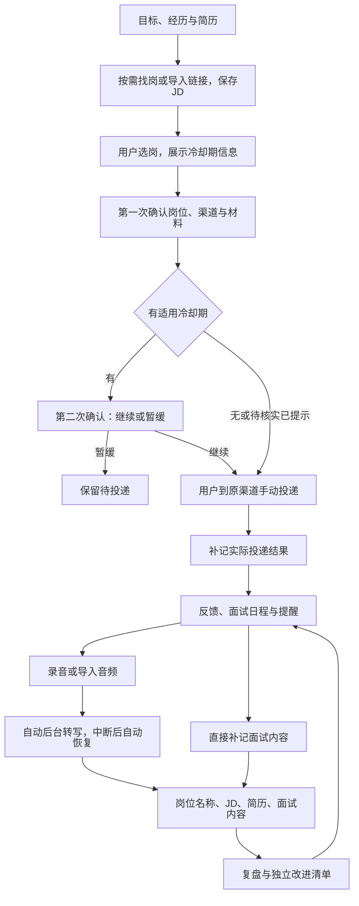

# 求职助手：产品愿景与可行性草案

版本：v0.12 · 范围已按用户决定更新；设计已审，第 1 段仓储/应用服务已合并（进度同步 2026-11-05，愿景范围不变）
日期：2026-11-04
编写：砚砚（gpt-6-astra）
本版修订：宪宪（gpt-6-astra）
讨论来源：`thread_mw054lyzfwenomr8`

本文记录产品方向、核心体验和需要验证的边界。仓库已完成第 1 段仓储与应用服务的代码复审、合并和[隔离验收](docs/storage-acceptance-2026-11-05.md)，完整产品尚未实现；其他设计、接入能力和验收目标不代表已经交付。

本版更新：依据 2026-11-04 用户决定，首版由用户手动投递，自动投递移出首版；冷却期简化为“有则二次确认”，取消练手/重点分支与跨岗位影响推演。复盘使用岗位名称、JD、简历和面试内容；来源按能力按需扩展；音频保存后自动后台转写，中断、休眠或服务重启后自动恢复；改进清单独立保存。信息输入作为系统功能、本地数据与文字分析边界继续有效。

## 1. 愿景

围绕每一次求职机会，帮助国内求职者发现合适岗位、判断投递时机、准备并推进投递、管理面试，再通过有证据的复盘改善下一次求职表现。

首批明确服务用户本人，围绕其实际求职流程验证产品。面向更多用户的开放方式后续再讨论。

助手根据用户目标、真实经历与求职记录，帮助用户发现岗位、准备材料及改进面试表现。用户选择求职机会并手动投递，AI 承担搜索、材料整理、进度记录与面试分析。自动投递不属于首版。

产品的底层是一份**自己维护的信息底座**，两个输入口都由系统承担：

- **用户侧输入**：求职目标与限定条件、真实经历、简历及其他材料版本，经用户确认后存为系统记录，后续判断与材料整理都从这里取，而不是每次对话重新口述。
- **岗位侧输入**：从已接入来源取得的岗位与 JD 原文、原链接、获取时间与获取方式，落库后供筛选、匹配、投递与复盘复用，而不是靠一次性的网页读取。

两个输入口都要求可复现、可追溯、可声明验证状态。当前证据只覆盖岗位侧的一部分：美团在本项目内可复现，猎聘与腾讯为另一 Agent 的实测记录、尚未迁入项目；用户侧的档案与材料输入尚未验证。任一输入口都不得按已实现表述。

产品保留两个核心板块：

1. **投递管理**：求职目标、岗位发现与筛选、投递限制、投递执行、沟通和进度跟进。
2. **面试总结**：面试安排与提醒、录音或音频导入、转写、结合 JD 的复盘与改进。

建议把面试前准备和复盘后的练习纳入第二板块，连接每一轮面试。

## 2. 哪些方向已经明确

以下来自用户在本次讨论中明确提出的需求，是本草案的基础。

| 已明确方向 | 具体含义 |
|---|---|
| 产品定位 | 找工作的助手，覆盖投递管理与面试总结 |
| 首批用户 | 用户本人；按其实际求职目标和经历开展验证 |
| 岗位发现 | 用户先说明岗位方向和限定条件，AI 主动寻找岗位并取得完整 JD |
| 信息输入 | 用户侧资料（目标、经历、材料）与岗位侧信息（岗位与 JD 原文）都是系统功能：由系统采集、落库、可追溯，后续流程复用同一份记录，不依赖对话中的临时提供或临时上网 |
| 选岗权 | 用户选择岗位、核对材料并在原渠道手动提交，系统不代为发送申请 |
| 目标来源 | 首批延续猎聘、BOSS 直聘和企业招聘官网；企业官网先验证阿里、腾讯、美团，后续可扩展 |
| 来源扩展 | 后续新增岗位来源时，应主要增加对应接入模块及配置，无需重写机会管理、投递和面试核心流程 |
| 投递方式 | 首版不做自动投递；助手准备材料、提供申请入口、保存用户补记的结果 |
| 反馈回收 | 需要关联投递及后续信息；具体消息入口和同步方式仍待确定 |
| 面试安排 | 支持手动记录，也希望可以自动添加，并提供日历提醒 |
| 面试资料 | 支持面试录音或音频导入；保存后自动在本地后台转写，中断或重启后自动恢复 |
| 部署约束 | 语音转文字在本地完成，音频保留本机；转写文本不做云端存储和同步，可用于外部模型分析；首版纯电脑端、暂不做结构化数据同步 |
| 面试复盘 | 输入为岗位名称、JD、简历、面试发生的内容，输出有依据的分析和独立改进清单 |
| 冷却期检查 | 检查公司或岗位是否有适用的冷却期说明，保存来源与已知期限，未知如实标注 |
| 冷却期确认 | 第一次确认岗位、渠道和简历；有适用冷却期时第二次确认，之后由用户手动投递；无或待核实不新增确认 |
| 简化范围 | 不设练手/重点分类，不计算对其他岗位的连带影响，不做投递顺序优化或次数限制规则引擎 |

后文数据组织和具体实现是设计细化；上述产品方向以本次用户决定为准。自动投递、旧版练手/重点确认分支不再是首版要求。渠道能力、反馈入口、录音环境和模型服务仍需验证，不能按已实现表述。

产品名称暂不决定，本文继续使用“求职助手”作为工作名称。

## 3. 用户的一条完整使用路径

以下以你使用助手推进一次求职为例，说明从设定目标到面试复盘的具体体验。每一步都写明你的操作、助手的工作和你能看到的结果。已确认方向沿用第二节；页面内容、状态处理和交互细节属于本草案的设计建议，渠道自动化能力仍需验证。

### 3.1 说明想找什么工作，并准备个人材料

你填写岗位方向、工作城市、薪资预期、经验要求等条件，区分“必须满足”和“优先考虑”，也可以列出目标公司及不接受的条件。导入当前简历，补充真实经历，以及此前投过的公司、岗位和已知冷却期。

发起搜索至少明确岗位关键词和城市（可选“不限”）；薪资下限、经验、技术方向、目标公司和已有链接作为可选条件。验证文档中的“AI 应用开发”及校招、社招样本用于说明能力，不自动写入你的求职目标。

助手把这些信息整理成求职目标与个人档案，标出材料中缺失或相互矛盾的内容，请你修正。后续寻找岗位、整理材料和复盘面试都复用这份档案，避免每次重新填写；目标变化时可以修改。

**这一步的结果：** 一份你确认的求职目标、可使用的材料，以及已知的历史投递记录。

### 3.2 AI 寻找岗位，给出可比较的候选清单

你发起一次按需搜索。助手按来源选择获取方式：猎聘从搜索列表提取岗位，腾讯使用已获实测支持的页面渲染路径，美团使用本地脚本已验证的公开查询路径；BOSS 当前以搜索发现的具体链接或你提供的链接补充单个岗位。各来源的实际能力范围见 4.2，不把单岗详情可读当成列表搜索可用。

先取得岗位列表和基本字段，合并疑似重复并按已知硬条件初筛，再为候选补齐职责与任职要求。若列表已包含这两部分，就保存其原文，无需机械重复访问详情页。输出岗位标题、公司、薪资、地点、经验、匹配理由、原链接、获取时间与资料完整性；每条来源记录保留原文，供后续选岗和复盘使用。

候选清单同时展示符合哪些条件、哪些条件不符合或尚不明确，以及判断所依据的 JD 内容。薪资、工作地点等未披露信息标为未知；未取得完整 JD 的岗位标明资料缺失。同一岗位在多个渠道出现时提示关联或疑似重复，无法访问的来源也会明确显示。

**冷却期随候选一起显示**：检查公司或岗位是否有适用的冷却期信息，标为“有 / 无（有依据）/ 待核实”，展示来源及已知期限。查不到规则不等于没有冷却期；不按岗位用途分类，不推演其他岗位受到的影响。

**这一步的结果：** 一份可追溯来源、区分 JD 完整或待补齐、比较匹配理由，并已标注冷却期状态的岗位清单。

### 3.3 由你选岗，检查是否适合现在投递

你查看候选岗位，决定收藏、暂缓、放弃，或加入待投递清单；助手可以解释和建议，最终选择由你完成。

针对选中的机会，助手展示历史投递记录及适用冷却期说明，帮助你核对是否继续。冷却期只承担提示和二次确认；未知期限不猜测，暂缓的岗位保留在清单中。

**这一步的结果：** 由你选定的待投递清单，以及每个岗位的限制检查结果和待处理事项。

### 3.4 确认岗位与材料，有冷却期再确认一次

助手根据真实经历整理简历和申请所需材料。你第一次确认具体岗位、投递渠道和简历版本；缺失事实在这一步补充，不由 AI 编造。

如果有适用的冷却期，助手展示来源和已知期限，你第二次选择“知道了，继续去投递”或“暂不投递”。没有适用冷却期则只需第一次确认；尚未核实时在第一次确认页面提示，不额外弹窗。没有练手/重点分类或第三次授权确认。

**这一步的结果：** 本次岗位与材料已准备好，有冷却期时已由你明确知悉。

### 3.5 在原渠道手动投递，补记结果

首版由你在招聘平台或公司官网完成提交。助手提供原申请链接与已准备的材料，不自动填写、发送简历或点击提交。

打开链接只表示准备去投递。你提交后补记时间、渠道、使用的简历及结果，可附回执或截图；明确确认已提交才记录为已投递。结果不清楚时保留“结果待确认”，暂缓或取消保持未投递。补记是在记录已发生的事实，不是新增一次授权弹窗。

已在其他地方投递过的申请可以直接补录，不倒逼用户重走投递前确认。

**这一步的结果：** 一条有用户确认或回执依据的投递记录。

### 3.6 收集招聘反馈，知道每个机会进行到哪里

投递后，你在机会列表中查看各岗位的最新进度、最近反馈和下一步行动。对于已授权且验证可读的消息入口，助手同步信息；其他入口可以导入消息文本、截图或手动补记，例如记录一次电话沟通。

助手把消息关联到具体机会，整理补材料、笔试、面试邀请、拒绝或 offer 等信息。无法确定消息属于哪个岗位时，请你确认关联；信息互相冲突时保留依据。页面显示最近成功同步时间，未读到消息或暂时没有回复都不会被直接记为拒绝。

**这一步的结果：** 每个机会都有可追溯的进度记录和待办事项，你能区分“没有回复”和“尚未同步到反馈”。

### 3.7 安排面试，并集中准备所需资料

收到面试邀请后，你可以手动填写日程，也可以让助手从邀请中提取日期、时间、轮次、形式和会议链接。信息完整且满足你设定的授权条件时可自动建日程；时间或岗位关联不明确时先请你确认。

面试与对应机会关联，改期、取消和重复邀请更新同一场日程。你可以设置提醒，在准备页查看该岗位 JD、当次投递的简历、相关项目及上轮需要改进的内容。本机关闭或休眠时的提醒能力会明确标注，不承诺未经验证的送达效果。

**这一步的结果：** 一条准确关联岗位和轮次的面试日程，以及集中展示本次准备材料的页面。

### 3.8 录制或导入音频，在本地完成转写

面试时，你在完成必要的录音告知与授权后主动开始录制，先确认双方声音可被采集；也可以在面试结束后导入已有音频。助手展示录制、保存和处理状态，语音转文字在本机完成，不因转写而上传音频。

转写完成后，你可以对照音频校对术语、关键回答和说话人角色，文字保留对应时间点。录音结束或音频导入保存后，后台自动开始转写，无需再点“开始”。中断、休眠或服务重启后自动恢复未完成任务；只有文件缺失、模型未就绪或反复失败等需要处理的情况才提示。没有录音时，也可以填写面试回忆，并保留资料来源标记。

**这一步的结果：** 一份关联本轮面试、可以校对和回看依据的文字记录。

### 3.9 结合 JD 复盘，得到具体的改进建议

你选择本轮面试记录发起复盘。助手结合该场面试对应的岗位名称、JD、简历和面试内容，梳理问了什么、你如何回答、哪些回答体现了岗位要求，以及哪些部分还需要补充证据或改善表达。

报告中的判断关联具体原话或时间点，明确区分回答不足和本次没有被问到的能力。例如，JD 要求项目推进能力，而回答只描述了团队最终结果，助手可以指出个人职责、关键取舍和结果证据尚不清楚，并建议你补充哪些真实信息。转写校正后，受影响的分析需要更新。

转写文本保存在本机，不加入产品的云端存储或跨设备同步。用户已明确这一边界不排除外部模型分析，因此文字复盘可以调用现成的大模型 API；具体服务、发送范围及费用在接入时说明和配置。

**这一步的结果：** 一份有证据的面试复盘，以及按优先级排列、可以执行的改进事项。

### 3.10 将改进带入下一轮，记录最终结果

你选择要落实的改进项，补充项目细节、练习回答或准备向招聘方确认的问题。下一轮面试准备时，助手带出相关内容；修改简历会形成新版本，已经投递的历史材料保持可追溯。

机会继续推进时追加面试轮次；收到 offer、被拒绝或主动退出时记录结果。若结束流程有招聘方提供的冷却期说明，保存依据并安排到期检查。到期只提醒重新核验冷却期信息，再次投递仍由你选择岗位并手动完成。

**这一步的结果：** 一段完整的求职历史，以及能用于下一次投递和面试的经历整理与改进记录。

### 从已有进度进入流程

使用助手时，你可能已经投过简历、收到面试邀请，或者只想复盘一场已完成的面试。可以从相应步骤补录资料，不要求重走找岗和投递；缺少 JD、当次简历或录音时明确提示影响，并允许后续补齐。

### 流程图速览

下图辅助回顾上述文字步骤；完整使用路径以文字说明为准。

## 4. 投递管理：建议的产品行为

### 4.1 求职目标、经历和材料

- 目标条件区分硬性要求与偏好，包括岗位方向、城市、薪资、经验要求、工作方式及用户不接受的条件。
- 个人档案记录用户确认的工作、项目、技能与成果，作为匹配和材料整理的依据。
- 每次申请保存对应的简历及其他材料版本，后续更新个人简历不覆盖历史提交材料。
- AI 可以帮助选择和组织真实经历；事实缺失时提出待补充项，不编造经验、数字或资历。
- 建议支持关注目标公司，以及记录用户放弃岗位的原因，用于调整后续推荐。

### 4.2 来源、岗位质量与跨渠道管理

当前找岗证据来自两处：用户提供、由另一 Agent 编写的[岗位获取能力说明 v1.0](docs/job-search-capability.md)（2026-11-03，以下称“能力说明”），以及本项目的[美团公开岗位样本验证](validation/results/public-job-2026-11-03/ASSESSMENT.md)。前者记录实际搜索结果，后者保留可运行脚本及原始响应；另一 Agent 的成功经验可作为接入依据，本项目尚未重跑其猎聘、腾讯和 BOSS 路径。

| 来源 | 当前获取方式与证据 | 接入时仍需验证 |
|---|---|---|
| 猎聘 | 能力说明记录：搜索“AI 应用开发”取得 42 个岗位，HTML 列表含标题、公司、薪资、地点；详情页可提供职责和要求 | 固化列表解析与详情获取，验证部分详情登录限制、字段缺失、条件筛选及更新 |
| 腾讯招聘官网 | 能力说明记录：页面渲染后取得至少 9 个社招岗位及 JD；普通 HTTP 获取空壳不代表找岗失败 | 将渲染路径接入项目，逐条核对职责和要求、详情链接、更新日期与技术依赖 |
| 美团招聘官网 | 本地脚本已跑通公开列表 → 岗位编号 → 对应详情，保存一份职责和要求原文及完整响应 | 目标条件、更多样本、时效和持续运行；当前样本为校招，不代表用户招聘类型 |
| BOSS 直聘 | 能力说明记录：搜索引擎发现的具体岗位链接、用户提供的链接可作为单岗详情读取入口；列表搜索尚未跑通 | 具体详情链接的可读范围与完整性、登录或访问失败处理；不承诺全部链接可读 |
| 阿里招聘官网 | 本地仅确认集团招聘入口可达；新增能力说明未提供阿里实际列表或 JD 样本 | 具体业务板块、列表、详情及申请入口 |
| 字节跳动招聘官网 | 能力说明提供页面结构及搜索线索，尚未取得经验证的完整列表与 JD | 作为扩展候选继续验证；不据此增加首批必交付范围 |

行业新闻和搜索摘要可用于发现线索、补充背景，不代替实际 JD、岗位仍开放的证明或适用冷却期规则。能力说明中的岗位数量只代表当次搜索，不作为当前库存、覆盖率或稳定性承诺。

建议每条来源记录保存原链接、来源岗位标识（如可得）、JD 原文、获取方式、获取时间、最后核验时间、招聘公司和发布者；分别记录职责、任职要求是否完整。只取得标题、摘要或部分职责时标为待补齐，不用 AI 补写成“完整 JD”。缺失薪资、经验、学历保留未知；猎聘匿名公司名称保留原样，不猜测实际雇主。原始内容与 AI 的解释分开展示，岗位关闭或内容变化时保留历史版本。

同一机会可以关联官网、BOSS、猎聘等多个发布记录。仅有标题相同不足以自动合并；证据不充分时提示疑似重复，由用户确认。招聘公司、招聘代理和实际联系人分别记录，各渠道的沟通及投递记录独立保留。

AI 主动找岗保留为核心目标。用户提供文本、截图和来源链接作为补充入口；单个渠道验证失败时，应明确影响范围，再讨论替代来源或产品取舍。

当前验证聚焦按需搜索，尚未实现持续监控新岗位或批量全站采集。来源获取方案与后续验证详见[岗位与 JD 获取方案](docs/jd-acquisition-strategy.md)。

#### 可扩展接入原则

来源可扩展是用户已确认的要求。建议先在同一项目内实现独立的接入模块，通过统一的数据约定连接核心功能；平台的页面、字段和登录差异由对应模块处理。

- **分开岗位来源、投递渠道和反馈渠道。** 例如，在猎聘发现机会、到公司官网投递、从邮件收到面试邀请，是同一个机会的三条关联记录。邮箱接入可以只提供反馈读取，不需要具备岗位搜索能力。
- **按能力声明支持范围。** 首版接入能力包括搜索、详情读取及只读反馈同步，分别声明“已验证支持、待验证或不支持”，并记录验证范围、依据、工具环境和时间。材料准备由应用服务承担；自动提交不在首版接口中。另一 Agent 样本、本地可复现脚本及产品已接入分别记录。账号连接、授权有效性及最近同步结果单独展示，不把未授权误写成永久不支持。
- **统一岗位和事件的基本信息。** 岗位记录包含来源及来源记录标识、原链接、公司、岗位、完整 JD 和获取时间；投递结果及反馈事件包含关联机会、渠道、来源事件标识（如可得）、发生时间和证据。渠道特有信息可以保留，但不强迫其他渠道提供不存在的字段。
- **核心流程复用。** 匹配、跨渠道关联、冷却期、材料版本、日程与复盘使用统一记录；通过来源注册和配置启用新模块。已有能力范围内的新来源，主要新增模块、字段或状态映射及测试。出现新的业务能力时，可以明确扩展公共约定，评估兼容性后再接入。
- **各渠道独立运行。** 一个来源断连或解析失败，不阻断其他来源。停用来源或撤回账号授权后，已有岗位、申请和反馈历史仍保留；再次同步需要避免重复创建或覆盖人工确认的事实。

扩展性验收：接入第二个真实来源时，验证无需重写核心流程；同一来源记录再次出现不生成重复岗位；来源中断和停用不丢历史；原有来源的完整路径继续通过测试。具体接口与实现结构在进入设计阶段时细化。

### 4.3 手动投递、沟通与反馈

首版采用“AI 准备、用户提交并补记”。助手保存当次岗位名称、JD、简历版本、投递渠道与用户确认；原渠道提交由用户完成。自动投递延后，今后重新讨论范围并验证，不以任何渠道可读为理由在首版开启提交能力。

投递准备状态与真实申请结果分开：材料已确认、打开申请页都不是已投递。用户明确补记或提供可核验回执后，记录已提交；不确定时记为结果待确认。保存发生时间、渠道和依据，允许纠正；用户在其他渠道已有的历史可以直接补录。

沟通、发送简历和正式申请分别记录。例如，“向猎头发送材料”不等于招聘公司已收到正式申请。首版不由助手对外发送消息或材料。

反馈保留三类入口：经授权且验证可读的只读同步、用户导入邮件/文本/截图、电话等手动补记。同步入口可以独立接入，不必具备搜索能力；具体邮箱或平台尚待确认。原始依据与 AI 识别结果分开，识别结果允许校正。

无法确定消息属于哪个机会时，先进入待关联列表；冲突时保留依据，不直接覆盖人工确认。每个入口显示最近成功同步时间，离线恢复后可补取并去重。无回复、同步失败和授权失效分别表达，不把它们自动记为拒绝。

首版使用本机主动同步或导入，不要求公网回调服务。私人聊天和电话信息由用户提供，不据此声称系统能自动读取私人账号。只读接入先用隔离样本验证；连接实际账号时明确所需权限及撤回方式。

机会进度支持笔试、多轮面试、拒绝、offer、主动退出等结果，保留下一步行动与提醒。

### 4.4 冷却期：有则二次确认

首版只检查：**所选公司或岗位有没有适用于本次投递的冷却期说明。** 依据可以是招聘方规则、平台提示、HR 通知或用户补记；展示规则原文、适用对象、来源、核验时间及已知期限。若信息写明当前受限或投递后需等待，统一作为“有冷却期”提示，不另设不同的确认流程。

| 检查结果 | 用户看到 | 投递准备中的确认次数 |
|---|---|---|
| 有适用冷却期 | 来源、说明和已知期限；不明期限明确标未知 | 两次：材料确认，然后冷却期确认 |
| 有依据说明无适用冷却期 | 依据与核验时间 | 一次材料确认 |
| 待核实 | 暂未查清，保留未知 | 在第一次确认中提示，不新增弹窗 |

第二次只提供“知道了，继续去投递 / 暂不投递”。确认不解除平台限制，也不代表已经提交；后续实际投递均由用户在原渠道完成。上述次数指本应用的投递准备流程，不包含招聘平台自己的提交页面；应用不能阻止用户独立访问平台。

不设练手/重点分类，不推演其他机会受影响的范围，不建立次数限制或投递顺序优化引擎。用户可以修改不准确的冷却期记录并保留依据；到期只提醒核验，不自动推断平台已解除限制。

## 5. 面试总结：建议的产品行为

### 5.1 安排、提醒与准备

每场面试关联一个求职机会和具体轮次，记录时间、时区、形式、地点或会议链接。支持手动添加和从邀请内容提取；自动创建所需的条件及授权范围待审核。

邀请内容完整、关联明确时可以按用户授权创建日程；信息冲突或缺失时保留待确认状态。改期和取消应更新已有日程，重复收到同一邀请不重复创建。首版提醒按本机运行条件设计，需分别验证主窗口关闭、后台进程退出及电脑休眠等状态下的行为，并明确补同步和错过提醒的展示方式。

建议提供面试准备页：岗位重点、当次简历、相关真实项目、上轮复盘的改进点，以及用户准备向招聘方确认的问题。

### 5.2 录音、导入与转写

- 录音由用户主动发起，提供必要的录音告知与授权交互；可导入已有音频。
- 语音转文字已确定在本机执行，音频不因转写而发送给云端语音服务。模型初始化如需联网下载，应显示下载进度，并与面试音频处理区分。
- 录制前检查采集来源和声音，显示录制状态，并验证求职者与面试方两侧音频。
- 录音结束或导入的音频安全保存后，自动创建持久化后台转写任务。关闭窗口不终止任务；中断、休眠、重启后自动恢复，已完成任务不重复生成。正常过程无需用户重启或重复点击；异常时保留进度并解释处理办法。
- 本机休眠或关机时不处理音频。恢复运行后重启必要的服务/worker 并继续未完成工作；用户主动暂停或取消的任务不自动重启。模型不支持断点时可自动从头转写，仍复用同一任务与结果身份。
- 转写保留时间点，允许修正术语、错字和说话人角色；无法确定角色时明确标记。
- 无法取得音频时，允许填写面试回忆，并标明其与录音转写的来源差异。

浏览器标签页、桌面会议软件和线下面试是不同的采集场景。Chrome 的标签页采集需要用户触发；网页共享音频能力还受浏览器、操作系统及共享对象影响。首版支持哪些场景，必须经过实测后确定。[Chrome 官方文档](https://developer.chrome.com/docs/extensions/reference/api/tabCapture)、[MDN 音频采集说明](https://developer.mozilla.org/en-US/docs/Web/API/MediaDevices/getDisplayMedia)（本次查阅：2026-11-03）

本地转写引擎和模型尚未选定。选择时需要在目标电脑上测量中文与术语识别、多人或重叠语音、长录音的处理时间、内存及存储占用，以及说话人角色的可校对性。模型下载完成后，应验证断网情况下可对本地音频完成转写。具体硬件要求和处理速度不能仅凭“采用本地方案”推定。

### 5.3 基于证据的复盘与改进

复盘输入已确认是四项：**岗位名称、JD、简历、面试发生的内容**。面试内容来自转写或用户回忆，区分来源；报告固定使用该场面试对应的材料版本。缺项时指出分析范围，不编造缺失信息；允许直接补录面试而没有投递记录。

语音本地转写已经确定；“转写文本不上云”现明确为不做云端存储和跨设备同步，不排除将所需文字发送给外部模型做分析。匹配与复盘可使用现成的大模型 API，接入时确定服务、发送范围和费用。产品不上传音频进行转写，也不把转写全文加入云同步；外部服务自身的请求留存条件需要核实，不能将本产品不存储表述为服务商必然零留存。

报告建议包含：

1. 面试问题与回答摘要，支持回看对应原文或音频。
2. 岗位要求与回答证据的对应关系。
3. 表现充分的部分、回答不充分的部分，以及本次没有覆盖的部分。
4. 有优先级的改进建议和可执行练习。
5. 用户需要向招聘方进一步确认的问题。

评价围绕回答是否切题、证据是否充分、是否体现岗位能力和表达是否清晰展开。应区分原始事实、分析判断和建议；未覆盖不能直接判为能力不足，不从语气推断录用概率或招聘方心理。

用户修改关键转写或角色后，应提示相关分析需要更新。改进清单独立于报告保存，每项有内容、具体行动、优先级、状态、用户备注及来源；可标记是否有用和是否完成。重算报告不覆盖用户编辑或完成进度，下一轮准备直接复用未完成项。具体实体见 [整体架构](docs/architecture.md)。

## 6. 使用信任与数据原则（建议纳入产品约束）

- 搜索整理、读取授权反馈、创建个人日程、录音和文字外发分析分别定义权限。首版不自动发送消息、简历或申请；用户可暂停后台任务、撤回账号授权。
- 简历、投递、日程、录音、转写和复盘默认持久保存，不因自动过期丢失。定时清理仅在用户主动选择后启用；支持主动删除和数据导出。
- 本地语音处理、数据存储同步与模型分析分别定义：语音转文字在本机完成、音频保留本机；转写文本不做云端存储和同步，但可用于外部模型分析。不自建语音处理云服务的决定继续有效。
- 首版为纯电脑端，暂不做结构化数据的跨设备同步；应用与数据在本机运行、持久保存。本机的后台进程或本地服务不属于需要自行部署的云服务器。是否使用桌面界面或本地网页，由录音、提醒和渠道验证结果决定。
- 虽首版不同步，数据应按"可同步分层"设计，避免后续加同步时重构。建议分层如下：

| 数据类别 | 首版存储 | 未来是否同步 | 说明 |
|---|---|---|---|
| 求职目标、个人档案、简历版本 | 本机 | 是 | 核心结构化数据 |
| 岗位记录、JD、投递记录与状态 | 本机 | 是 | 跨设备与重装不丢 |
| 面试日程、提醒、投递限制/冷却期 | 本机 | 是 | 未来可由云端定时提醒 |
| 反馈消息（文本/截图/补记） | 本机 | 是 | 离线期间可由云端补取 |
| 复盘改进清单（有优先级的改进项及完成状态） | 本机 | 是 | 体积小，跨设备复习需要；已确认跟随进度同步 |
| 原始音频 | 本机 | 否 | 体积大且含他人语音，仅本机 |
| 转写全文 | 本机 | 否 | 不做云端存储和同步；可按配置发送所需文字给外部模型分析 |
| 复盘报告全文 | 本机 | 否 | 仅在打开应用时查看 |

- 文字匹配或复盘可调用外部模型 API，接入时说明服务、传输范围、费用与服务方留存条件，避免通过应用日志、云备份或同步间接保存转写全文。跨设备云同步不作为首版运行前提，但数据结构与删除/导出设计应兼容未来同步（例如“删除一个机会”需可扩展到同时清理未来云副本）。
- 删除操作应说明范围，例如只删原始音频，还是连同转写和复盘一并删除；如后续另行启用外部处理，相关第三方副本也需纳入删除设计。
- 连接账号时只申请所需权限，允许撤回。授权失效时显示需要重新连接，不伪造同步成功。
- JD、邮件、聊天内容和音频转写属于待分析资料，其中的指令不能改变助手权限或触发未经授权的外部动作。
- 测试与验证使用隔离数据和明确授权的样本，不能指向用户的真实运行数据存储。

## 7. 可行性判断与证据缺口

整体判断：找岗与 JD 获取已有另一 Agent 的猎聘、腾讯实测记录及本地美团样本，具备继续接入的依据。首版按本人使用、本地转写与手动投递验证两大板块；渠道稳定性、反馈回收、录音兼容性、后台恢复、本地性能和复盘质量仍需实测。自动投递已移出首版。目前没有渠道接入成功率、转写准确率、单次成本或开发工期的验证结果。

| 能力 | 方案级判断 | 实现前需要补的证据 |
|---|---|---|
| 目标、经历、材料版本和机会管理 | 路径明确 | 典型使用任务与数据关系核对 |
| 新来源扩展 | 模块化接入路径明确，尚未实现 | 接入第二个真实来源时核心流程复用、重复同步不重复建档、原有来源回归通过 |
| AI 主动找岗与完整 JD 获取 | 猎聘、腾讯有另一 Agent 实测记录，美团有本地脚本样本；BOSS 单岗读取与列表搜索分别处理 | 项目内固化与复现、职责和要求完整性、条件筛选、时效及覆盖范围；阿里、字节实际岗位读取仍待验证 |
| 岗位匹配与推荐 | 可做，效果需验证 | 符合硬性条件的比例、推荐理由是否有依据、用户是否采纳 |
| 手动投递管理 | 首版方式已确认 | 材料与冷却期确认、原渠道入口、结果补记及重复记录处理 |
| 反馈回收 | 只能覆盖可读取的信息，首版以本机同步或导入验证 | 实际入口、关联准确性、改期或状态冲突、本机离线后的补同步 |
| 冷却期提示 | 有则两次确认，无或待核实一次 | 信息依据、适用对象、取消与继续分支；不做复杂规则推演 |
| 日程与提醒 | 首版本机路径明确；关闭应用后提醒受本机运行限制 | 重复邀请、时区、改期、取消及关闭应用后的送达（云同步后可改善，但不在首版范围） |
| 音频导入与录制 | 导入路径明确；录制依赖环境 | 首批设备和会议场景的双侧音频、长录音与中断测试 |
| 本地后台转写和说话人角色 | 自动开始、重启恢复已确认，模型与性能需验证 | 处理时间、资源占用、断网转写、术语及多人样本；关闭窗口、杀进程和休眠恢复不丢任务、不重复产物 |
| JD 复盘 | 可使用外部模型分析，效果与接入条件需验证 | 服务与发送范围、留存条件及费用；结论证据、事实错误及用户评价 |

公开页面可见不等于持续自动获取、代投或读取私人反馈已获支持。国内渠道的结论要基于各自证据；本草案不把未找到公开接口当作“不可能实现”的证明。

## 8. 首个可用版本的范围建议

首批服务用户本人，交付路径：目标与简历 → 至少一个已验证来源的 AI 找岗 → 用户选岗 → 确认材料（有冷却期再确认一次）→ 用户手动投递并补记 → 进度跟进 → 面试安排 → 音频导入或已验证场景录制 → 自动后台本地转写与校对 → 结合岗位名称、JD、简历和面试内容复盘 → 独立改进清单。

首版把“信息输入”按系统能力交付，而不是验证脚本一次性跑通：岗位侧至少一个已实证来源的接入模块、本地岗位与 JD 记录、可复现的获取日志，构成最小闭环；用户侧的目标、经历与材料输入同样是首版必需，不能只做一个导入按钮而正文仍由对话承载。两个输入口各自标注验证状态，未验证的一侧不得显示为可用。

首批来源范围已确认：猎聘、BOSS 直聘和企业官网；企业官网先验证阿里、腾讯、美团。具体业务板块、岗位与接入顺序按实际目标和验证结果细化，不再将首批企业名单列为未定。

根据新增证据，接入工作优先固化猎聘列表与详情、腾讯渲染获取，并复用美团公开查询样本；BOSS 先覆盖具体岗位链接读取，阿里继续定位实际岗位入口。字节作为后续扩展候选。此处细化获取路径，不扩大首版为全平台覆盖；当前按需搜索与人工投递演示也不等同于首版整体交付。

自动投递不在首版，未来是否开展由后续范围决定。至少一个来源的 AI 主动找岗仍是首版验收项；若所有候选来源都无法提供可持续路径，需带验证结果回到范围讨论。来源列表是接入候选，不是写死的产品枚举；以后按需增加模块及配置。

本地语音转写、音频保留本机、转写不做云端存储和同步，以及首版纯电脑端、暂不做结构化数据同步是首版约束。文字分析可以调用外部 API；应用形态、本地转写模型及外部模型服务由验证结果推荐。

自动投递、跨岗位限制推演、全平台覆盖、全设备录音、录用概率预测、面试中实时生成回答，均不作为首版验收目标。是否扩展需另行讨论。

## 9. 验证顺序与“可用”的判断

以下是分阶段验证方案。独立验证脚本及执行记录位于 `validation/`；公开页面连通性、岗位内容、手动投递记录与反馈读取分别验收，不能以 HTTP 200 代替完整能力通过。首版不进行自动提交验收。

截至 2026-11-03 的历史证据（本轮未重跑）：新增[能力说明](docs/job-search-capability.md)记录猎聘 42 个岗位、腾讯渲染后至少 9 个岗位及 JD、BOSS 单岗链接读取路径；本地[美团样本](validation/results/public-job-2026-11-03/ASSESSMENT.md)保留脚本和原始响应。腾讯的项目内普通 HTTP 探测仍为空壳，与另一 Agent 渲染后取得岗位的结果适用条件不同。下一步是固化已取得成功证据的路径；阿里及字节的完整岗位读取、个人反馈和适用冷却期仍待验证；自动投递不在首版。

| 顺序 | 验证任务 | 应交付的证据 |
|---|---|---|
| 1 | 固化猎聘列表与详情、腾讯渲染找岗路径，复用美团样本；补充 BOSS 单岗读取、阿里实际岗位入口 | 保存实际查询条件、来源 URL/岗位标识、获取方式与环境、职责及要求原文、时间和失败状态；取得完整 JD 后再评估匹配；按用户条件核对样本，不将另一 Agent 实测或 HTTP 200 写成产品接入完成；只读反馈另行验收，自动投递不在首版 |
| 2 | 接入第二个真实来源，验证按能力扩展 | 新来源主要增加模块、映射、配置及测试；原有核心流程和来源继续可用；停用后历史保留 |
| 3 | 走通手动投递与简单冷却期提示 | 有适用冷却期两次确认，无或待核实一次；取消保留草稿，打开链接不记成功，实际结果由用户补记或回执支撑；已有投递直接补录 |
| 4 | 检验录音及自动后台转写恢复 | 双侧声音、长录音、权限拒绝、导入；断网转写；关窗口、杀 worker、重启服务、休眠后自动恢复；主动暂停不自动重启，完成记录不重复 |
| 5 | 用经过授权的代表性面试样本评估复盘，并验证本机运行边界 | 按配置的文字模型处理且不做转写云存储或同步；人工核对问题、原话、角色和结论；建议评价、耗时与成本；后台关闭、休眠后的同步及提醒行为 |

产品效果建议持续观察：找到符合硬条件机会的时间、重复或无效投递、跟进遗漏、需要用户纠正的记录、复盘建议采纳情况，以及处理时间和成本。阈值在样本与目标人群确定后制定，不预先承诺准确率或录用率提升。

进入实现时遵循测试先行：先为目标行为编写并运行测试，确认旧实现因行为缺失或错误失败，再修改实现；完成后运行相关测试与完整测试套件。验证脚本的行为调整也遵循这一要求；纯文档调整不要求行为测试。

## 10. 决定记录与剩余问题

以下状态根据用户当前明确说明更新，不能把已确认事项重新当成开放选择，也不能把产品目标写成已经实现。

| 编号 | 状态 | 已确认内容 | 剩余细化或验证 |
|---|---|---|---|
| D1 | 已确认 | 首批服务用户本人 | 使用其实际求职场景、材料和目标；不预设已知其社招或校招身份 |
| D2 | 已由 2026-11-04 决定更新 | 首版不做自动投递，由用户手动提交并补记 | 材料准备、原渠道入口、结果记录；只读反馈渠道与授权待细化 |
| D3 | 已确认并强化扩展要求 | 猎聘、BOSS 和企业官网是首批候选；企业官网先验证阿里、腾讯、美团，来源按需增加、不固定枚举 | 各来源独立能力接口、配置、契约测试及接入顺序 |
| D4a | 已确认 | 语音转文字在本机完成，音频保留本机；转写不做云端存储和同步，可用于外部模型分析 | 本地转写模型与性能；外部模型服务、发送范围、费用及留存条件 |
| D4b | 已确认（首版范围） | 首版为纯电脑端，暂不做结构化数据的跨设备同步 | 数据按可同步分层设计；后续加同步时的冲突合并与删除/导出扩展 |
| D5 | 已确认 | 复盘改进清单未来随进度一起同步 | 同步开关与粒度；首版先存本机 |
| D6 | 已由 2026-11-04 决定简化 | 有适用冷却期时两次确认：材料一次、冷却期一次；无或待核实只在第一次显示信息 | 来源、期限、继续与暂缓；确认不代表解除限制或投递成功 |
| D7 | 旧规则由 2026-11-04 决定撤下 | 首版不区分练手/重点，不做跨岗位影响推演 | 不再作为首版设计或验收要求 |
| D8 | 文档依据已确认 | 用户提供另一 Agent 的岗位获取能力说明，要求据此更新项目文档 | 纳入猎聘、腾讯及 BOSS 的记录并保留美团本地证据；接入环境、长期稳定性和只读反馈另验收；自动投递延后，不把验证关键词当成用户目标 |
| D9 | 已确认 | 信息输入属于系统功能：用户侧资料与岗位侧 JD 都由系统采集、落库、可追溯，不依赖对话中的临时提供或临时上网 | 用户侧档案与材料输入尚未验证；岗位侧仅美团在本项目内可复现，猎聘与腾讯为另一 Agent 实测、需迁入项目后才可按产品接入表述 |
| D10 | 已确认 | 复盘材料为岗位名称、JD、简历、面试发生的内容 | 版本引用、原话证据及资料缺失提示 |
| D11 | 已确认 | 转写放后台自动执行；中断、休眠、服务重启后自动恢复，尽量无感知 | 持久化任务、worker 恢复、结果去重、需用户处理的异常 |
| D12 | 已授权设计 | 改进清单独立实体由开发设计，保持 D5 的未来同步边界 | 稳定标识、来源、优先级、状态、用户编辑与报告重算隔离 |

文字分析边界已明确，不再重复询问是否允许外部模型分析。后续确定具体服务、发送范围和费用，并验证其留存条件。首版纯电脑端、暂不同步结构化数据的决定继续有效。

后续需补充的使用信息：首批公司的具体业务板块与岗位方向、主要设备与面试软件、常见反馈渠道，以及可接受的处理等待时间。具体模型、界面形态和技术框架由需求与验证结果推荐，不把技术选型交给用户猜测。

文档整体继续处于审核草案阶段；新增决定已同步到前文各段，尚未确认的补充建议不自动视为通过。

## 11. 讨论依据与状态

下表保留历次讨论事实；与旧版本不同的当前范围以 v0.12 正文和 D2/D6/D7/D10–D12 为准。
| 依据 | 对本草案的影响 |
|---|---|
| 2026-11-03：用户提出求职助手的完整流程 | 明确两大板块、AI 找岗、用户选岗、面试录音与 JD 复盘 |
| 2026-11-03：用户要求补充遗漏并评估可行性 | 加入材料版本、例外流程、面试准备、权限和验证方案等建议 |
| 2026-11-03：用户提出简历冻结期 | 纳入跨渠道历史、投递限制检查和到期提醒 |
| 2026-11-03：用户明确猎聘、BOSS 和企业官网 | 收敛国内来源范围；具体接入能力保持待验证 |
| 2026-11-03：用户要求先形成文档审核 | 本文状态为 v0.1 审核草案，未定稿、未开始实现 |
| 2026-11-03：用户要求来源可扩展，并询问如何确认投递和反馈方式 | 更新为 v0.2；加入独立接入、按能力验证、渠道方式选择及结果核验，名称讨论暂缓 |
| 2026-11-03：用户确认先服务本人、本人选岗与材料授权后代投、现有目标来源、本地语音转文字且不搭服务器 | 更新为 v0.3；同步已确认决定及首版约束，文字分析模型调用方式与反馈入口继续待定 |
| 2026-11-03：用户指出第三节图中没有文字，编写者误解为正文不足 | 更新为 v0.4；补充十步文字说明，但未解决图中节点文字不显示的问题 |
| 2026-11-03：用户澄清是流程图框内文字未渲染 | 更新为 v0.5；为本图设置顶层 `htmlLabels: false`，使用 SVG 文字标签，避免 HTML 标签在 SVG 清理时被移除 |
| 2026-11-03：用户澄清"不搭服务器"实指语音不上云，同步仍需要云；并确认改进清单随进度同步、首版纯电脑端暂不同步 | 更新为 v0.6；区分本地语音处理与数据同步，新增数据可同步分层与 D4a/D4b/D5，修正部署约束表述 |
| 2026-11-03：用户修改冷却期相关正文，并要求更新版本号、追加记录；投递前应获知冷却期影响，避免练手投递打乱后续重点岗位安排 | 更新为 v0.7；记录四项调整：①冷却期前瞻化，投递前展示将触发的限制、持续时间和受影响机会；②找岗即标注无限制、受限或待核实；③确认最多两次，材料与授权确认后，仅按限制情况追加影响确认；④待核实的重点岗位轻量确认，非重点岗位仅清单提示，未知不等于无限制或禁止投递。本次仅更新版本号、本版说明与本条记录，保留用户修改的正文 |
| 2026-11-03：用户决定有冷却期时默认不自动投递，由用户手动投递或手动确认投递 | 更新为 v0.8；统一冷却期默认暂停、手动投递或明确确认代投两条路径，未确认保持待处理；沿用第二次确认，同步使用流程、流程图、验收项及 D6 决定记录 |
| 2026-11-03：用户采纳练手岗位影响重点机会时轻量确认，明确转写仅不做云存储和同步，并指定阿里、腾讯、美团先验证 | 更新为 v0.9；同步轻量确认范围与 D7，统一文字可用于外部分析的边界，确定首批企业官网验证样本；启动独立只读验证，实际代投与私人反馈仍需对应账号及授权证据 |
| 2026-11-03：用户提供另一 Agent 的 `docs/job-search-capability.md`，要求据其找岗验证结果调整项目文档 | 更新为 v0.10；纳入猎聘 42 个岗位、腾讯渲染后至少 9 个岗位及 JD、BOSS 单岗链接路径的实测记录，保留美团脚本样本；同步来源能力、获取流程、完整性要求、接入任务与 D8。区分另一 Agent 实测、本地复现和产品接入；当前不能代投不改写为取消授权代投目标 |
| 2026-11-03：用户明确“信息输入应该是系统里的功能”，并确认岗位 JD 已有可实验的实证 | 更新为 v0.11；把信息输入确立为系统一等能力（用户侧资料 + 岗位侧 JD 两个入口），同步愿景、已明确方向、首版范围与 D9；明确两侧验证状态不对称，仍不把验证脚本或另一 Agent 实测写成产品接入完成 |
| 2026-11-04：用户在架构审查后重新收敛首版 | 更新为 v0.12：冷却期有则两次确认，取消练手/重点及跨岗推演；首版手动投递；复盘明确四项输入；来源按需扩展；转写后台自动执行并恢复；独立设计改进清单。同步更新架构与获取方案，历史验证结果不变 |

外部资料的查阅日期和证据适用范围已随对应段落注明；实施前需复核变化。本文不包含开发完成、接入完成或测试通过的声明。
