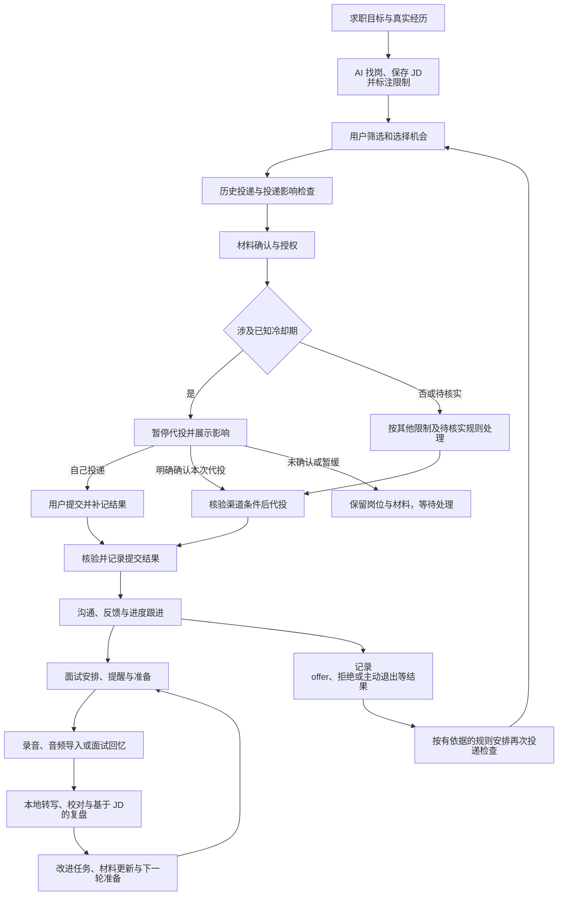

# 求职助手：产品愿景与可行性草案

版本：v0.10 · 待审核  
日期：2026-11-03  
编写：砚砚（gpt-6-astra）  
讨论来源：`thread_mw054lyzfwenomr8`

本文用于确认产品方向、核心体验和需要验证的边界。产品功能尚未进入实现阶段，当前开展独立的可行性验证；文中的建议、接入能力和验收目标，不代表已经实现。

本版更新：依据用户提供的[岗位获取能力说明](docs/job-search-capability.md)，纳入猎聘列表、腾讯渲染后岗位及 JD、BOSS 单岗链接读取的实测记录，与已有美团公开接口样本合并；按来源细化找岗方式、字段完整性和接入验证任务。当前工具不支持的代投与私人消息读取单独说明，授权代投仍为产品目标；冷却期确认、本地转写和文字分析边界沿用已有决定。

## 1. 愿景

围绕每一次求职机会，帮助国内求职者发现合适岗位、判断投递时机、准备并推进投递、管理面试，再通过有证据的复盘改善下一次求职表现。

首批明确服务用户本人，围绕其实际求职流程验证产品。面向更多用户的开放方式后续再讨论。

助手根据用户目标、真实经历、历史投递和招聘限制，帮助用户判断：投什么、何时投、优先投哪个，以及下一次面试应该如何改进。用户选择求职机会，AI 在明确授权和渠道支持的范围内承担搜索、整理与执行工作。

产品保留两个核心板块：

1. **投递管理**：求职目标、岗位发现与筛选、投递限制、投递执行、沟通和进度跟进。
2. **面试总结**：面试安排与提醒、录音或音频导入、转写、结合 JD 的复盘与改进。

建议把面试前准备和复盘后的练习纳入第二板块，连接每一轮面试。

## 2. 哪些方向已经明确

以下来自用户在本次讨论中明确提出的需求，是本草案的基础。

| 已明确方向 | 具体含义 |
|---|---|
| 产品定位 | 找工作的助手，覆盖投递管理与面试总结 |
| 首批用户 | 用户本人；按其实际求职目标和经历开展验证 |
| 岗位发现 | 用户先说明岗位方向和限定条件，AI 主动寻找岗位并取得完整 JD |
| 选岗权 | 必须由用户选择要投递的岗位；材料授权不自动扩展为任意选岗或海投授权 |
| 目标来源 | 首批延续猎聘、BOSS 直聘和企业招聘官网；企业官网先验证阿里、腾讯、美团，后续可扩展 |
| 来源扩展 | 后续新增岗位来源时，应主要增加对应接入模块及配置，无需重写机会管理、投递和面试核心流程 |
| AI 代投 | 用户希望实现：选定岗位并授权使用材料后，由 AI 代投；逐渠道验证能否执行和核验结果 |
| 反馈回收 | 需要关联投递及后续信息；具体消息入口和同步方式仍待确定 |
| 面试安排 | 支持手动记录，也希望可以自动添加，并提供日历提醒 |
| 面试资料 | 支持面试录音或音频导入；语音转文字在本地完成 |
| 部署约束 | 语音转文字在本地完成，音频保留本机；转写文本不做云端存储和同步，可用于外部模型分析；首版纯电脑端、暂不做结构化数据同步 |
| 面试复盘 | 结合对应岗位 JD 分析面试表现，给出改进建议 |
| 再次投递限制 | 纳入简历冻结期、冷却期等限制，避免遗漏投递时机或无效重复申请 |
| 冷却期执行规则 | 涉及已知且适用的冷却期时默认暂停自动投递；由用户手动投递，或明确确认本次代投后再执行，未确认不提交 |
| 待核实轻量确认 | 本岗位为重点，或本次投递可能影响已关注的重点机会时，需要轻量确认；练手岗位同样适用，沿用第二次确认 |

后文对数据组织、状态及具体实现的细化，除上表已确认方向外，仍为供审核的设计建议。首批用户、选岗前提、授权代投目标、来源范围、冷却期确认规则、本地转写、转写不做云端存储和同步及首版纯电脑端已经明确。渠道能力、反馈入口、录音环境、具体模型服务及其配置仍需补充或验证。

产品名称暂不决定，本文继续使用“求职助手”作为工作名称。

## 3. 用户的一条完整使用路径

以下以你使用助手推进一次求职为例，说明从设定目标到面试复盘的具体体验。每一步都写明你的操作、助手的工作和你能看到的结果。已确认方向沿用第二节；页面内容、状态处理和交互细节属于本草案的设计建议，渠道自动化能力仍需验证。

### 3.1 说明想找什么工作，并准备个人材料

你填写岗位方向、工作城市、薪资预期、经验要求等条件，区分“必须满足”和“优先考虑”，也可以列出目标公司及不接受的条件。导入当前简历，补充真实经历，以及此前投过的公司、岗位和已知冷却期。

发起搜索至少明确岗位关键词和城市（可选“不限”）；薪资下限、经验、技术方向、目标公司和已有链接作为可选条件。验证文档中的“AI 应用开发”及校招、社招样本用于说明能力，不自动写入你的求职目标。

助手把这些信息整理成求职目标与个人档案，标出材料中缺失或相互矛盾的内容，请你修正。后续寻找岗位、整理材料和复盘面试都复用这份档案，避免每次重新填写；目标变化时可以修改。

**这一步的结果：** 一份你确认的求职目标、可使用的材料，以及已知的历史投递记录。

### 3.2 AI 寻找岗位，给出可比较的候选清单

你发起一次按需搜索。助手按来源选择获取方式：猎聘从搜索列表提取岗位，腾讯使用已获实测支持的页面渲染路径，美团使用本地脚本已验证的公开查询路径；BOSS 当前以搜索发现的具体链接或你提供的链接补充单个岗位。各来源的实际能力范围见 4.2，不把单岗详情可读当成列表搜索可用。

先取得岗位列表和基本字段，合并疑似重复并按已知硬条件初筛，再为候选补齐职责与任职要求。若列表已包含这两部分，就保存其原文，无需机械重复访问详情页。输出岗位标题、公司、薪资、地点、经验、匹配理由、原链接、获取时间与资料完整性；每条来源记录保留原文，供后续选岗和复盘使用。

候选清单同时展示符合哪些条件、哪些条件不符合或尚不明确，以及判断所依据的 JD 内容。薪资、工作地点等未披露信息标为未知；未取得完整 JD 的岗位标明资料缺失。同一岗位在多个渠道出现时提示关联或疑似重复，无法访问的来源也会明确显示。

**冷却期在找岗阶段就随候选一起核对**：助手对每个候选机会查询是否存在适用的冷却期或次数限制，并在清单中直接标注"无限制 / 受限（说明范围与解除时间）/ 待核实"。用户在浏览候选时就能按限制状态排序和取舍，不必等到准备投递才发现某个岗位会占用后续窗口。规则或历史不完整时标为待核实，不把未知当成无限制，也不把待核实当成禁止投递。

**这一步的结果：** 一份可追溯来源、区分 JD 完整或待补齐、比较匹配理由，并已标注冷却期状态的岗位清单。

### 3.3 由你选岗，检查是否适合现在投递

你查看候选岗位，决定收藏、暂缓、放弃，或加入待投递清单；助手可以解释和建议，最终选择由你完成。

针对选中的机会，助手在**你确认投递之前**就检查：此前是否投递过、是否仍有招聘流程进行中，以及**这次投递将会触发哪些冷却期、次数限制或流程占用**。展示的不只是"当前能否投"，而是"投了之后会锁住什么"——受限的公司/岗位范围、锁定时长、到期时间，以及对后续其他机会的连带影响。这样你可以据此安排先后：例如先用不重要的岗位练手，把重点岗位留到不受限的时机。规则或历史不完整时标为待核实，不把未知等同于没有限制，也不把"可能受限"直接当成"禁止投递"。需要暂缓的岗位可以保留关注，不必重新搜索。

**这一步的结果：** 由你选定的待投递清单，以及每个岗位的限制检查结果和待处理事项。

### 3.4 确认本次材料，并授权投递

助手根据岗位要求，从你的真实经历中整理适用的简历内容、附件和表单回答，展示本次准备发送的材料。你核对内容，确认具体岗位、投递渠道和材料版本，并授权助手提交；可以一次确认明确列出的多个岗位。

已有档案可以复用，针对岗位新写的内容仍需核对事实。遇到缺失经历、无法确定的表单答案或需要你作出的承诺，助手提出具体待补充项。材料授权的范围对应所选岗位，不自动扩展到未选岗位。

**投递确认最多两次，不额外增加**：第一次确认材料与授权（发什么、投哪个渠道）。涉及已知且适用的冷却期时，助手先暂停自动投递，展示限制及其对后续机会的影响；你可以选择自己去原渠道投递，或在第二次确认中明确选择让助手继续本次代投。没有确认或选择暂缓时，保留岗位和材料，不提交。其他限制及待核实情形按 4.4 的规则处理；无限制影响的岗位只需第一次确认。

**这一步的结果：** 每个待投岗位都有对应的材料版本和授权范围，可随时查看当时准备提交什么。

### 3.5 执行投递，并确认是否真的提交成功

对于已验证支持且取得授权的渠道，助手在满足限制处理条件后执行投递并核验结果，记录时间、渠道、材料版本及可获取的回执。涉及已知冷却期的申请，在你明确确认本次代投之前保持待处理；选择手动投递时，由你完成后提供结果，助手不会同时另行提交。你能看到待处理、正在提交、已确认提交、失败或结果待确认等状态。

如果出现新的必填问题、需要人工登录验证或材料不足，助手保留进度并指出需要你处理的事项。网络超时或结果不明时，先核查是否已经提交，不直接重复投递。暂时无法代投的渠道会明确说明原因，并提供原申请入口和已准备的材料，由你决定是否手动完成并补记。

**这一步的结果：** 一条有结果依据的投递记录；未完成的申请说明卡在哪里、下一步由谁处理。

### 3.6 收集招聘反馈，知道每个机会进行到哪里

投递后，你在机会列表中查看各岗位的最新进度、最近反馈和下一步行动。对于已授权且验证可读的消息入口，助手同步信息；其他入口可以导入消息文本、截图或手动补记，例如记录一次电话沟通。

助手把消息关联到具体机会，整理补材料、笔试、面试邀请、拒绝或 offer 等信息。无法确定消息属于哪个岗位时，请你确认关联；信息互相冲突时保留依据。页面显示最近成功同步时间，未读到消息或暂时没有回复都不会被直接记为拒绝。

**这一步的结果：** 每个机会都有可追溯的进度记录和待办事项，你能区分“没有回复”和“尚未同步到反馈”。

### 3.7 安排面试，并集中准备所需资料

收到面试邀请后，你可以手动填写日程，也可以让助手从邀请中提取日期、时间、轮次、形式和会议链接。信息完整且满足你设定的授权条件时可自动建日程；时间或岗位关联不明确时先请你确认。

面试与对应机会关联，改期、取消和重复邀请更新同一场日程。你可以设置提醒，在准备页查看该岗位 JD、当次投递的简历、相关项目及上轮需要改进的内容。本机关闭或休眠时的提醒能力会明确标注，不承诺未经验证的送达效果。

**这一步的结果：** 一条准确关联岗位和轮次的面试日程，以及集中展示本次准备材料的页面。

### 3.8 录制或导入音频，在本地完成转写

面试时，你在完成必要的录音告知与授权后主动开始录制，先确认双方声音可被采集；也可以在面试结束后导入已有音频。助手展示录制、保存和处理状态，语音转文字在本机完成，不因转写而上传音频。

转写完成后，你可以对照音频校对术语、关键回答和说话人角色，文字保留对应时间点。处理失败或中断时展示已保存内容和恢复入口；没有录音时，也可以填写面试回忆，并保留资料来源标记。

**这一步的结果：** 一份关联本轮面试、可以校对和回看依据的文字记录。

### 3.9 结合 JD 复盘，得到具体的改进建议

你选择本轮面试记录发起复盘。助手结合当时的 JD、提交材料和面试文字，梳理问了什么、你如何回答、哪些回答体现了岗位要求，以及哪些部分还需要补充证据或改善表达。

报告中的判断关联具体原话或时间点，明确区分回答不足和本次没有被问到的能力。例如，JD 要求项目推进能力，而回答只描述了团队最终结果，助手可以指出个人职责、关键取舍和结果证据尚不清楚，并建议你补充哪些真实信息。转写校正后，受影响的分析需要更新。

转写文本保存在本机，不加入产品的云端存储或跨设备同步。用户已明确这一边界不排除外部模型分析，因此文字复盘可以调用现成的大模型 API；具体服务、发送范围及费用在接入时说明和配置。

**这一步的结果：** 一份有证据的面试复盘，以及按优先级排列、可以执行的改进事项。

### 3.10 将改进带入下一轮，记录最终结果

你选择要落实的改进项，补充项目细节、练习回答或准备向招聘方确认的问题。下一轮面试准备时，助手带出相关内容；修改简历会形成新版本，已经投递的历史材料保持可追溯。

机会继续推进时追加面试轮次；收到 offer、被拒绝或主动退出时记录结果。若结束流程触发了有依据的再次投递限制，更新对应记录并安排到期检查。到期只提醒重新核验岗位与规则，再次投递仍需你选岗并授权。

**这一步的结果：** 一段完整的求职历史，以及能用于下一次投递和面试的经历整理与改进记录。

### 从已有进度进入流程

使用助手时，你可能已经投过简历、收到面试邀请，或者只想复盘一场已完成的面试。可以从相应步骤补录资料，不要求重走找岗和投递；缺少 JD、当次简历或录音时明确提示影响，并允许后续补齐。

### 流程图速览

下图辅助回顾上述文字步骤；完整使用路径以文字说明为准。

## 4. 投递管理：建议的产品行为

### 4.1 求职目标、经历和材料

- 目标条件区分硬性要求与偏好，包括岗位方向、城市、薪资、经验要求、工作方式及用户不接受的条件。
- 个人档案记录用户确认的工作、项目、技能与成果，作为匹配和材料整理的依据。
- 每次申请保存对应的简历及其他材料版本，后续更新个人简历不覆盖历史提交材料。
- AI 可以帮助选择和组织真实经历；事实缺失时提出待补充项，不编造经验、数字或资历。
- 建议支持关注目标公司，以及记录用户放弃岗位的原因，用于调整后续推荐。

### 4.2 来源、岗位质量与跨渠道管理

当前找岗证据来自两处：用户提供、由另一 Agent 编写的[岗位获取能力说明 v1.0](docs/job-search-capability.md)（2026-11-03，以下称“能力说明”），以及本项目的[美团公开岗位样本验证](validation/results/public-job-2026-11-03/ASSESSMENT.md)。前者记录实际搜索结果，后者保留可运行脚本及原始响应；另一 Agent 的成功经验可作为接入依据，本项目尚未重跑其猎聘、腾讯和 BOSS 路径。

| 来源 | 当前获取方式与证据 | 接入时仍需验证 |
|---|---|---|
| 猎聘 | 能力说明记录：搜索“AI 应用开发”取得 42 个岗位，HTML 列表含标题、公司、薪资、地点；详情页可提供职责和要求 | 固化列表解析与详情获取，验证部分详情登录限制、字段缺失、条件筛选及更新 |
| 腾讯招聘官网 | 能力说明记录：页面渲染后取得至少 9 个社招岗位及 JD；普通 HTTP 获取空壳不代表找岗失败 | 将渲染路径接入项目，逐条核对职责和要求、详情链接、更新日期与技术依赖 |
| 美团招聘官网 | 本地脚本已跑通公开列表 → 岗位编号 → 对应详情，保存一份职责和要求原文及完整响应 | 目标条件、更多样本、时效和持续运行；当前样本为校招，不代表用户招聘类型 |
| BOSS 直聘 | 能力说明记录：搜索引擎发现的具体岗位链接、用户提供的链接可作为单岗详情读取入口；列表搜索尚未跑通 | 具体详情链接的可读范围与完整性、登录或访问失败处理；不承诺全部链接可读 |
| 阿里招聘官网 | 本地仅确认集团招聘入口可达；新增能力说明未提供阿里实际列表或 JD 样本 | 具体业务板块、列表、详情及申请入口 |
| 字节跳动招聘官网 | 能力说明提供页面结构及搜索线索，尚未取得经验证的完整列表与 JD | 作为扩展候选继续验证；不据此增加首批必交付范围 |

行业新闻和搜索摘要可用于发现线索、补充背景，不代替实际 JD、岗位仍开放的证明或适用冷却期规则。能力说明中的岗位数量只代表当次搜索，不作为当前库存、覆盖率或稳定性承诺。

建议每条来源记录保存原链接、来源岗位标识（如可得）、JD 原文、获取方式、获取时间、最后核验时间、招聘公司和发布者；分别记录职责、任职要求是否完整。只取得标题、摘要或部分职责时标为待补齐，不用 AI 补写成“完整 JD”。缺失薪资、经验、学历保留未知；猎聘匿名公司名称保留原样，不猜测实际雇主。原始内容与 AI 的解释分开展示，岗位关闭或内容变化时保留历史版本。

同一机会可以关联官网、BOSS、猎聘等多个发布记录。仅有标题相同不足以自动合并；证据不充分时提示疑似重复，由用户确认。招聘公司、招聘代理和实际联系人分别记录，各渠道的沟通及投递记录独立保留。

AI 主动找岗保留为核心目标。用户提供文本、截图和来源链接作为补充入口；单个渠道验证失败时，应明确影响范围，再讨论替代来源或产品取舍。

当前验证聚焦按需搜索，尚未实现持续监控新岗位或批量全站采集。来源获取方案与后续验证详见[岗位与 JD 获取方案](docs/jd-acquisition-strategy.md)。

#### 可扩展接入原则

来源可扩展是用户已确认的要求。建议先在同一项目内实现独立的接入模块，通过统一的数据约定连接核心功能；平台的页面、字段和登录差异由对应模块处理。

- **分开岗位来源、投递渠道和反馈渠道。** 例如，在猎聘发现机会、到公司官网投递、从邮件收到面试邀请，是同一个机会的三条关联记录。邮箱接入可以只提供反馈读取，不需要具备岗位搜索能力。
- **按能力声明支持范围。** 搜索岗位、获取 JD、准备材料、提交申请、查询提交结果和读取反馈分别声明“已验证支持、待验证或不支持”，并记录验证范围、依据、工具环境和时间。另一 Agent 的样本验证、本地可复现脚本及产品已接入分别记录，不能把其中一种写成另外两种。账号是否已连接、授权是否有效、最近同步是否成功单独展示，不能把未授权误写成永久不支持。
- **统一岗位和事件的基本信息。** 岗位记录包含来源及来源记录标识、原链接、公司、岗位、完整 JD 和获取时间；投递结果及反馈事件包含关联机会、渠道、来源事件标识（如可得）、发生时间和证据。渠道特有信息可以保留，但不强迫其他渠道提供不存在的字段。
- **核心流程复用。** 匹配、跨渠道关联、冷却期、材料版本、日程与复盘使用统一记录；通过来源注册和配置启用新模块。已有能力范围内的新来源，主要新增模块、字段或状态映射及测试。出现新的业务能力时，可以明确扩展公共约定，评估兼容性后再接入。
- **各渠道独立运行。** 一个来源断连或解析失败，不阻断其他来源。停用来源或撤回账号授权后，已有岗位、申请和反馈历史仍保留；再次同步需要避免重复创建或覆盖人工确认的事实。

扩展性验收：接入第二个真实来源时，验证无需重写核心流程；同一来源记录再次出现不生成重复岗位；来源中断和停用不丢历史；原有来源的完整路径继续通过测试。具体接口与实现结构在进入设计阶段时细化。

### 4.3 投递执行、沟通与反馈

用户已明确希望实现“本人选岗、授权材料后由 AI 代投”。代投作为产品目标已经确认；各渠道的可执行能力和反馈方式分别验证。实际执行时，授权应关联所选岗位和材料版本；本次愿景确认没有指定要立即投递的真实岗位。

新增能力说明中的“不能登录、不能代投、不能读取站内消息”描述其当前工具范围。现阶段可演示的是找岗、整理与输出原链接，投递和反馈由用户操作、导入或补记；这份记录没有验证自动提交，也没有取消本项目的授权代投目标。登录要求本身不能证明永远无法自动化，后续仍按具体渠道验证。

以授权代投为目标，并保留以下执行方式处理不同渠道的能力差异；具体开放范围以验证结果为准：

| 投递方式 | 用户做什么 | 助手做什么 | 提交结果依据 |
|---|---|---|---|
| 用户提交并补记 | 在原渠道完成申请，确认岗位、时间和材料 | 保存关联记录，提示缺失信息 | 用户确认，或用户提供的提交记录 |
| AI 准备、用户提交 | 审阅材料并在原渠道提交 | 整理材料和表单答案；渠道允许且验证可用时辅助填写 | 可读取的回执，或用户确认；打开页面、填写表单不代表提交 |
| 用户授权、AI 代投 | 选岗、确认材料并明确授权，可按明确清单批量确认；涉及已知冷却期时明确确认本次代投 | 涉及已知冷却期先暂停，取得对应人工确认后再按渠道条件提交；核验结果并保留凭据 | 可核验的成功回执或查询结果；人工确认继续不等于已经提交，结果不明时保留待确认 |

反馈建议并行支持三类入口：用户授权且已验证的自动同步；用户导入的邮件、消息文本或截图；电话等场景的手动补记。每个事件都标明其来源，导入图片识别和 AI 解释仍可能需要校对。

#### 如何确认采用哪些方式

1. **使用已确认的偏好，补充尚缺的渠道信息。** 用户选岗、授权材料后希望由 AI 提交的方向已经明确，无需重复询问。后续补充通常在哪里收到回复、愿意连接哪些消息入口。平台能否接入由验证回答，用户无需先判断接口或自动化技术。
2. **逐渠道验证并形成可审核的方式表。** 按 BOSS、猎聘和具体企业官网分别记录岗位获取、材料准备、提交、结果核验、反馈读取的能力；列出所需授权、证据、更新时间、维护条件及未确认项。企业官网能力不能仅凭一家结果推广到所有公司。
3. **用代表性路径演示实际结果。** 展示材料如何对应到岗位、提交后如何确认、消息如何关联申请、面试邀请如何转成日程，以及超时、重复消息和改期如何处理。先使用隔离样本、测试入口或不提交的演示；真实对外提交需另有针对实际岗位的用户授权。
4. **用户依据证据选择渠道方式。** 只把验证通过且获得对应授权的能力开放为自动执行。对待验证或暂不支持的能力，明确由用户提交、导入或补记的操作方式及体验影响；保留后续扩展目标。

当前已确认的投递目标是“用户选岗并授权材料，AI 在已验证渠道代投”。反馈仍建议采用授权同步与用户导入、补记并行的组合，等待实际使用渠道确定；BOSS、猎聘和各企业官网的自动投递、回执核验及个人反馈读取尚未验证，不能从岗位可读推导这些能力已可用。

沟通、发送简历和正式申请分别记录。例如，“向猎头发送材料”可以记录为已发送，但不能自动等同于招聘公司已收到正式申请。

系统应表达待投递、提交中、结果待确认、已确认提交和提交失败等情况。遇到超时或结果不明，先核验是否已经提交，避免重复申请。人工补记标明是用户确认；自动记录应关联可核验的回执或来源。

接入哪些邮箱和站内消息尚未确定。微信或电话中的招聘反馈也可由用户提供文本、截图或手动补记；这不代表能够直接读取私人微信、电话记录或录音。

首版优先验证本机主动同步和用户导入的路径，不把公网回调服务器作为运行前提。同步在什么条件下运行、离线后如何补取，以及本机未运行期间无法即时同步的范围，都应在验证结果中说明。

每次进度变化保留发生时间、来源和依据；不能把长期无回复自动记成拒绝。消息不能明确对应某个机会时，先进入待关联列表，不直接修改申请状态。

每个自动反馈入口显示最近成功同步时间及覆盖范围。同步失败或授权过期时显示连接状态，不能把“没有读取到数据”展示成“招聘方没有反馈”。消息冲突或用户否认 AI 识别结果时，保留原始依据并允许修正关联和状态。

建议支持笔试、多轮面试、主动撤回、拒绝、offer 和机会结束等结果，并为进行中的机会提供下一步行动和提醒。

### 4.4 投递限制与冷却期

把限制作为**投递前的决策依据**，而不只是投递后的状态标签。用户投递前就应看到"这次投递会占用哪些限制、锁多久、影响哪些后续机会"，以便规划投递顺序（例如先用非重点岗位练手，重点岗位避开冷却窗口）。限制记录与申请结果分别保存。

| 需要保存的内容 | 目的 |
|---|---|
| 限制类型 | 区分再次申请间隔、时间窗口内申请次数、并行申请数量或流程占用等规则 |
| 适用范围 | 明确公司、部门、岗位或岗位类别，以及校招、社招、招聘批次等条件 |
| 触发事件 | 明确是提交、拒绝、面试结束或其他有依据的事件触发 |
| 解除条件 | 保存起算时间、时长、结束日期，或需要招聘方确认的条件 |
| 来源与有效性 | 保存官方规则、系统提示、HR 通知或用户补记，以及核验时间 |
| 关联历史 | 包括使用助手之前及其他渠道的申请记录 |

推荐时显示受限原因、待核实项和下一次检查时间。涉及已知且适用的冷却期时，助手默认暂停相应的自动投递，无论岗位是否标为重点；这里包括当前仍在冷却期内，以及本次投递将按已知规则触发冷却期的情况。用户决定自己去原渠道投递，或明确确认让助手继续本次代投；未确认时不执行。未知规则不能被 AI 猜成固定天数，某岗位的限制也不能自行扩大到整家公司。

人工确认表示用户知悉影响并授权本次代投，不表示招聘平台已经解除限制。若渠道明确不接受当前申请，助手保留待处理并说明原因，不能把人工确认写成解除冷却期或提交成功。手动投递入口与实际提交结果分别记录。

倒计时结束后提示重新核验岗位、规则和材料，不直接断言招聘方已解除限制。更换渠道或上传新简历，不自动视为解除限制。用户可以纠正记录或补充 HR 例外通知，修改依据应保留。

#### 投递前的影响预览

限制状态在找岗阶段（见 3.2）就随候选清单展示，投递前再给出可读的"投递影响"预览。投递全流程的确认最多两次：材料与授权一次；涉及冷却期时追加一次影响确认，无影响则不再弹窗。预览回答三个问题：

1. **这次投递会触发什么限制**：明确规则类型、适用范围（公司/部门/岗位/岗位类别/批次）和起算事件。
2. **锁定多久、什么时候解除**：给出到期日期或"需招聘方确认"的待核实状态；规则不明时如实标为未知，不猜天数。
3. **会挡住哪些后续机会**：列出当前关注或待投递清单中，可能因这次投递而受限的岗位，让用户判断是否值得现在投。

若用户希望区分投递意图，可给岗位打"练手/重点"之类的轻量标记，助手据此在预览中提示"此投递可能占用重点岗位的窗口"。该标记仅用于规划提醒，不改变限制规则本身，也不作为自动决策依据。

第二次确认同时表达用户对影响的知情和本次执行选择。展示限制、适用范围、时长与可确定的解除时间后，提供“我自己投递”“确认让助手代投”“暂不投递”三个选择；该选择沿用第二次确认，不再追加确认。用户没有作出选择、取消或暂缓时，保留岗位与已准备材料，不记录为已投递。触发条件分两档：

- **已知冷却期或其他已确认限制**：无论是否重点岗位，先暂停自动投递并交由用户选择。选择手动投递后，助手等待用户补记或可核验的提交结果；选择助手代投后，仅执行明确确认的岗位与材料版本，并遵守实际渠道条件。
- **待核实**：本岗位标为重点，或本次投递可能影响已关注的重点机会时，弹一次轻量确认。练手岗位也按此判断，例如“该练手岗位的限制待核实，可能影响你关注的重点岗位，是否继续？”。展示可能关联的岗位和判断依据，不能仅凭“练手”标记免除确认；没有上述重点关联的非重点岗位只做清单内提示。轻量确认沿用第二次确认，不增加第三次。

无论哪一档，待核实都不被渲染成"禁止投递"，也不假装成"无限制"。

## 5. 面试总结：建议的产品行为

### 5.1 安排、提醒与准备

每场面试关联一个求职机会和具体轮次，记录时间、时区、形式、地点或会议链接。支持手动添加和从邀请内容提取；自动创建所需的条件及授权范围待审核。

邀请内容完整、关联明确时可以按用户授权创建日程；信息冲突或缺失时保留待确认状态。改期和取消应更新已有日程，重复收到同一邀请不重复创建。首版提醒按本机运行条件设计，需分别验证主窗口关闭、后台进程退出及电脑休眠等状态下的行为，并明确补同步和错过提醒的展示方式。

建议提供面试准备页：岗位重点、当次简历、相关真实项目、上轮复盘的改进点，以及用户准备向招聘方确认的问题。

### 5.2 录音、导入与转写

- 录音由用户主动发起，提供必要的录音告知与授权交互；可导入已有音频。
- 语音转文字已确定在本机执行，音频不因转写而发送给云端语音服务。模型初始化如需联网下载，应显示下载进度，并与面试音频处理区分。
- 录制前检查采集来源和声音，显示录制状态，并验证求职者与面试方两侧音频。
- 长录音应有保存状态、处理进度和失败恢复；中断后不把未完成文件或分析显示成成功。
- 转写保留时间点，允许修正术语、错字和说话人角色；无法确定角色时明确标记。
- 无法取得音频时，允许填写面试回忆，并标明其与录音转写的来源差异。

浏览器标签页、桌面会议软件和线下面试是不同的采集场景。Chrome 的标签页采集需要用户触发；网页共享音频能力还受浏览器、操作系统及共享对象影响。首版支持哪些场景，必须经过实测后确定。[Chrome 官方文档](https://developer.chrome.com/docs/extensions/reference/api/tabCapture)、[MDN 音频采集说明](https://developer.mozilla.org/en-US/docs/Web/API/MediaDevices/getDisplayMedia)（本次查阅：2026-11-03）

本地转写引擎和模型尚未选定。选择时需要在目标电脑上测量中文与术语识别、多人或重叠语音、长录音的处理时间、内存及存储占用，以及说话人角色的可校对性。模型下载完成后，应验证断网情况下可对本地音频完成转写。具体硬件要求和处理速度不能仅凭“采用本地方案”推定。

### 5.3 基于证据的复盘与改进

输入建议包括当时的 JD、当次材料、转写或面试回忆，以及用户补充的上下文。资料不完整时，报告说明影响范围。

语音本地转写已经确定；“转写文本不上云”现明确为不做云端存储和跨设备同步，不排除将所需文字发送给外部模型做分析。匹配与复盘可使用现成的大模型 API，接入时确定服务、发送范围和费用。产品不上传音频进行转写，也不把转写全文加入云同步；外部服务自身的请求留存条件需要核实，不能将本产品不存储表述为服务商必然零留存。

报告建议包含：

1. 面试问题与回答摘要，支持回看对应原文或音频。
2. 岗位要求与回答证据的对应关系。
3. 表现充分的部分、回答不充分的部分，以及本次没有覆盖的部分。
4. 有优先级的改进建议和可执行练习。
5. 用户需要向招聘方进一步确认的问题。

评价围绕回答是否切题、证据是否充分、是否体现岗位能力和表达是否清晰展开。应区分原始事实、分析判断和建议；未覆盖不能直接判为能力不足，不从语气推断录用概率或招聘方心理。

用户修改关键转写或角色后，应提示相关分析需要更新。改进项可进入下一轮准备，允许用户标记是否有用、是否练习，以及是否仍需改进。

## 6. 使用信任与数据原则（建议纳入产品约束）

- 搜索整理、创建个人日程、对外发送消息、提交申请分别定义授权范围；对外动作有可追溯记录，用户可暂停后续自动执行。
- 简历、投递、日程、录音、转写和复盘默认持久保存，不因自动过期丢失。定时清理仅在用户主动选择后启用；支持主动删除和数据导出。
- 本地语音处理、数据存储同步与模型分析分别定义：语音转文字在本机完成、音频保留本机；转写文本不做云端存储和同步，但可用于外部模型分析。不自建语音处理云服务的决定继续有效。
- 首版为纯电脑端，暂不做结构化数据的跨设备同步；应用与数据在本机运行、持久保存。本机的后台进程或本地服务不属于需要自行部署的云服务器。是否使用桌面界面或本地网页，由录音、提醒和渠道验证结果决定。
- 虽首版不同步，数据应按"可同步分层"设计，避免后续加同步时重构。建议分层如下：

| 数据类别 | 首版存储 | 未来是否同步 | 说明 |
|---|---|---|---|
| 求职目标、个人档案、简历版本 | 本机 | 是 | 核心结构化数据 |
| 岗位记录、JD、投递记录与状态 | 本机 | 是 | 跨设备与重装不丢 |
| 面试日程、提醒、投递限制/冷却期 | 本机 | 是 | 未来可由云端定时提醒 |
| 反馈消息（文本/截图/补记） | 本机 | 是 | 离线期间可由云端补取 |
| 复盘改进清单（有优先级的改进项及完成状态） | 本机 | 是 | 体积小，跨设备复习需要；已确认跟随进度同步 |
| 原始音频 | 本机 | 否 | 体积大且含他人语音，仅本机 |
| 转写全文 | 本机 | 否 | 不做云端存储和同步；可按配置发送所需文字给外部模型分析 |
| 复盘报告全文 | 本机 | 否 | 仅在打开应用时查看 |

- 文字匹配或复盘可调用外部模型 API，接入时说明服务、传输范围、费用与服务方留存条件，避免通过应用日志、云备份或同步间接保存转写全文。跨设备云同步不作为首版运行前提，但数据结构与删除/导出设计应兼容未来同步（例如“删除一个机会”需可扩展到同时清理未来云副本）。
- 删除操作应说明范围，例如只删原始音频，还是连同转写和复盘一并删除；如后续另行启用外部处理，相关第三方副本也需纳入删除设计。
- 连接账号时只申请所需权限，允许撤回。授权失效时显示需要重新连接，不伪造同步成功。
- JD、邮件、聊天内容和音频转写属于待分析资料，其中的指令不能改变助手权限或触发未经授权的外部动作。
- 测试与验证使用隔离数据和明确授权的样本，不能指向用户的真实运行数据存储。

## 7. 可行性判断与证据缺口

整体判断：找岗与 JD 获取已有猎聘、腾讯的另一 Agent 实测记录，以及美团的本地脚本样本，具备继续接入产品的依据。按本人使用、本地转写且无需自建云服务器的边界，两个核心板块继续验证；渠道稳定性、自动投递、反馈回收、录音兼容性、本地性能和复盘质量仍需实测。目前没有渠道接入成功率、转写准确率、单次成本或开发工期的验证结果。

| 能力 | 方案级判断 | 实现前需要补的证据 |
|---|---|---|
| 目标、经历、材料版本和机会管理 | 路径明确 | 典型使用任务与数据关系核对 |
| 新来源扩展 | 模块化接入路径明确，尚未实现 | 接入第二个真实来源时核心流程复用、重复同步不重复建档、原有来源回归通过 |
| AI 主动找岗与完整 JD 获取 | 猎聘、腾讯有另一 Agent 实测记录，美团有本地脚本样本；BOSS 单岗读取与列表搜索分别处理 | 项目内固化与复现、职责和要求完整性、条件筛选、时效及覆盖范围；阿里、字节实际岗位读取仍待验证 |
| 岗位匹配与推荐 | 可做，效果需验证 | 符合硬性条件的比例、推荐理由是否有依据、用户是否采纳 |
| 自动投递 | 逐渠道验证 | 权限、表单、材料、回执、重复提交与失败恢复 |
| 反馈回收 | 只能覆盖可读取的信息，首版以本机同步或导入验证 | 实际入口、关联准确性、改期或状态冲突、本机离线后的补同步 |
| 冷却期管理 | 记录和计算路径明确 | 规则来源、适用范围和历史记录是否完整 |
| 日程与提醒 | 首版本机路径明确；关闭应用后提醒受本机运行限制 | 重复邀请、时区、改期、取消及关闭应用后的送达（云同步后可改善，但不在首版范围） |
| 音频导入与录制 | 导入路径明确；录制依赖环境 | 首批设备和会议场景的双侧音频、长录音与中断测试 |
| 本地转写和说话人角色 | 本地执行已确认，模型与性能需验证 | 目标电脑的处理时间、资源占用、断网转写、术语、混合语言及多人样本 |
| JD 复盘 | 可使用外部模型分析，效果与接入条件需验证 | 服务与发送范围、留存条件及费用；结论证据、事实错误及用户评价 |

公开页面可见不等于持续自动获取、代投或读取私人反馈已获支持。国内渠道的结论要基于各自证据；本草案不把未找到公开接口当作“不可能实现”的证明。

## 8. 首个可用版本的范围建议

首批服务用户本人，建议交付一条同时覆盖投递管理和面试总结的完整路径：目标与简历 → 至少一个已验证来源的 AI 找岗 → 用户选岗 → 投递限制检查与材料授权 → 涉及冷却期先暂停，由用户手动投递或明确确认本次代投 → 核验并记录投递结果 → 进度跟进 → 面试安排 → 音频导入或已验证场景录制 → 本地转写校对 → JD 复盘。无相应限制时，按已确认授权在支持的渠道代投。

首批来源范围已确认：猎聘、BOSS 直聘和企业官网；企业官网先验证阿里、腾讯、美团。具体业务板块、岗位与接入顺序按实际目标和验证结果细化，不再将首批企业名单列为未定。

根据新增证据，接入工作优先固化猎聘列表与详情、腾讯渲染获取，并复用美团公开查询样本；BOSS 先覆盖具体岗位链接读取，阿里继续定位实际岗位入口。字节作为后续扩展候选。此处细化获取路径，不扩大首版为全平台覆盖；当前按需搜索与人工投递演示也不等同于首版整体交付。

授权后的 AI 代投是已确认的实现目标，按渠道验证结果开放；人工提交、资料导入和补记保持可用。至少一个来源的 AI 主动找岗属于建议的首版验收项；如果所有首批来源都无法提供可持续的找岗或代投路径，需要带验证结果回到范围讨论，不能默认移除这两个目标。

本地语音转写、音频保留本机、转写不做云端存储和同步，以及首版纯电脑端、暂不做结构化数据同步是首版约束。文字分析可以调用外部 API；应用形态、本地转写模型及外部模型服务由验证结果推荐。

全平台覆盖、全设备录音、无需用户选择的自动海投、录用概率预测、面试中实时生成回答，均不作为本草案的首版验收目标。是否扩展需另行讨论。

## 9. 验证顺序与“可用”的判断

以下是分阶段验证方案。独立验证脚本及执行记录位于 `validation/`；公开页面连通性、岗位内容、实际提交与个人反馈分别验收，不能以 HTTP 200 代替完整能力通过。

2026-11-03 当前证据：新增[能力说明](docs/job-search-capability.md)记录猎聘 42 个岗位、腾讯渲染后至少 9 个岗位及 JD、BOSS 单岗链接读取路径；本地[美团样本](validation/results/public-job-2026-11-03/ASSESSMENT.md)保留脚本和原始响应。腾讯的项目内普通 HTTP 探测仍为空壳，与另一 Agent 渲染后取得岗位的结果适用条件不同。下一步是固化已取得成功证据的路径；阿里及字节的完整岗位读取、代投、个人反馈和适用冷却期仍待验证。

| 顺序 | 验证任务 | 应交付的证据 |
|---|---|---|
| 1 | 固化猎聘列表与详情、腾讯渲染找岗路径，复用美团样本；补充 BOSS 单岗读取、阿里实际岗位入口 | 保存实际查询条件、来源 URL/岗位标识、获取方式与环境、职责及要求原文、时间和失败状态；取得完整 JD 后再评估匹配；按用户条件核对样本，不将另一 Agent 实测或 HTTP 200 写成产品接入完成；代投和反馈单独验收 |
| 2 | 接入第二个真实来源，验证按能力扩展 | 新来源主要增加模块、映射、配置及测试；原有核心流程和来源继续可用；停用后历史保留 |
| 3 | 走通跨渠道机会和冷却期场景（含找岗即标注、默认暂停、人工选择及最多两次确认） | 能区分发现来源、投递渠道和反馈渠道；已知冷却期未获人工确认时不提交；待核实的重点岗位，以及可能影响重点机会的练手岗位，均在第二次确认中提示；手动投递与确认代投两条路径可核验，取消或暂缓不记为已投递，确认不视为解除平台限制；重复消息、结果不明或同步失败不产生错误记录 |
| 4 | 在目标设备和会议场景检验音频及本地转写 | 双侧声音、长时录音、权限拒绝、中断和导入；模型准备后的断网转写、处理时间和资源占用 |
| 5 | 用经过授权的代表性面试样本评估复盘，并验证本机运行边界 | 按配置的文字模型处理且不做转写云存储或同步；人工核对问题、原话、角色和结论；建议评价、耗时与成本；后台关闭、休眠后的同步及提醒行为 |

产品效果建议持续观察：找到符合硬条件机会的时间、重复或无效投递、跟进遗漏、需要用户纠正的记录、复盘建议采纳情况，以及处理时间和成本。阈值在样本与目标人群确定后制定，不预先承诺准确率或录用率提升。

进入实现时遵循测试先行：先为目标行为编写并运行测试，确认旧实现因行为缺失或错误失败，再修改实现；完成后运行相关测试与完整测试套件。验证脚本的行为调整也遵循这一要求；纯文档调整不要求行为测试。

## 10. 决定记录与剩余问题

以下状态根据用户当前明确说明更新，不能把已确认事项重新当成开放选择，也不能把产品目标写成已经实现。

| 编号 | 状态 | 已确认内容 | 剩余细化或验证 |
|---|---|---|---|
| D1 | 已确认 | 首批服务用户本人 | 使用其实际求职场景、材料和目标；不预设已知其社招或校招身份 |
| D2 | 投递目标已确认；反馈入口待定 | 必须由用户选岗，材料授权后希望 AI 代投 | 每个渠道能否提交、如何核验结果；实际接收反馈的渠道及读取授权 |
| D3 | 来源范围已确认 | 首批为猎聘、BOSS 直聘和企业官网；企业官网先验证阿里、腾讯、美团，来源保持可扩展 | 具体业务板块与岗位、渠道能力及接入顺序 |
| D4a | 已确认 | 语音转文字在本机完成，音频保留本机；转写不做云端存储和同步，可用于外部模型分析 | 本地转写模型与性能；外部模型服务、发送范围、费用及留存条件 |
| D4b | 已确认（首版范围） | 首版为纯电脑端，暂不做结构化数据的跨设备同步 | 数据按可同步分层设计；后续加同步时的冲突合并与删除/导出扩展 |
| D5 | 已确认 | 复盘改进清单未来随进度一起同步 | 同步开关与粒度；首版先存本机 |
| D6 | 已确认 | 涉及已知且适用的冷却期时默认暂停自动投递；用户可手动投递，或明确确认本次代投后再执行；未确认不提交，沿用第二次确认 | 验证未确认、暂缓、手动投递、确认代投及渠道仍不接受申请时的行为；人工确认不等于解除限制或提交成功 |
| D7 | 已确认 | 待核实岗位本身为重点，或可能影响已关注的重点机会时，均触发轻量确认；练手岗位同样适用，沿用第二次确认 | 关联依据的展示与校正；避免漏掉练手岗位对重点机会的影响 |
| D8 | 文档依据已确认 | 用户提供另一 Agent 的岗位获取能力说明，要求据此更新项目文档 | 纳入猎聘、腾讯及 BOSS 的记录并保留美团本地证据；接入环境、长期稳定性和代投反馈另验收，不把验证关键词当成用户目标 |

文字分析边界已明确，不再重复询问是否允许外部模型分析。后续确定具体服务、发送范围和费用，并验证其留存条件。首版纯电脑端、暂不同步结构化数据的决定继续有效。

后续需补充的使用信息：首批公司的具体业务板块与岗位方向、主要设备与面试软件、常见反馈渠道，以及可接受的处理等待时间。具体模型、界面形态和技术框架由需求与验证结果推荐，不把技术选型交给用户猜测。

文档整体继续处于审核草案阶段；新增决定已同步到前文各段，尚未确认的补充建议不自动视为通过。

## 11. 讨论依据与状态

| 依据 | 对本草案的影响 |
|---|---|
| 2026-11-03：用户提出求职助手的完整流程 | 明确两大板块、AI 找岗、用户选岗、面试录音与 JD 复盘 |
| 2026-11-03：用户要求补充遗漏并评估可行性 | 加入材料版本、例外流程、面试准备、权限和验证方案等建议 |
| 2026-11-03：用户提出简历冻结期 | 纳入跨渠道历史、投递限制检查和到期提醒 |
| 2026-11-03：用户明确猎聘、BOSS 和企业官网 | 收敛国内来源范围；具体接入能力保持待验证 |
| 2026-11-03：用户要求先形成文档审核 | 本文状态为 v0.1 审核草案，未定稿、未开始实现 |
| 2026-11-03：用户要求来源可扩展，并询问如何确认投递和反馈方式 | 更新为 v0.2；加入独立接入、按能力验证、渠道方式选择及结果核验，名称讨论暂缓 |
| 2026-11-03：用户确认先服务本人、本人选岗与材料授权后代投、现有目标来源、本地语音转文字且不搭服务器 | 更新为 v0.3；同步已确认决定及首版约束，文字分析模型调用方式与反馈入口继续待定 |
| 2026-11-03：用户指出第三节图中没有文字，编写者误解为正文不足 | 更新为 v0.4；补充十步文字说明，但未解决图中节点文字不显示的问题 |
| 2026-11-03：用户澄清是流程图框内文字未渲染 | 更新为 v0.5；为本图设置顶层 `htmlLabels: false`，使用 SVG 文字标签，避免 HTML 标签在 SVG 清理时被移除 |
| 2026-11-03：用户澄清"不搭服务器"实指语音不上云，同步仍需要云；并确认改进清单随进度同步、首版纯电脑端暂不同步 | 更新为 v0.6；区分本地语音处理与数据同步，新增数据可同步分层与 D4a/D4b/D5，修正部署约束表述 |
| 2026-11-03：用户修改冷却期相关正文，并要求更新版本号、追加记录；投递前应获知冷却期影响，避免练手投递打乱后续重点岗位安排 | 更新为 v0.7；记录四项调整：①冷却期前瞻化，投递前展示将触发的限制、持续时间和受影响机会；②找岗即标注无限制、受限或待核实；③确认最多两次，材料与授权确认后，仅按限制情况追加影响确认；④待核实的重点岗位轻量确认，非重点岗位仅清单提示，未知不等于无限制或禁止投递。本次仅更新版本号、本版说明与本条记录，保留用户修改的正文 |
| 2026-11-03：用户决定有冷却期时默认不自动投递，由用户手动投递或手动确认投递 | 更新为 v0.8；统一冷却期默认暂停、手动投递或明确确认代投两条路径，未确认保持待处理；沿用第二次确认，同步使用流程、流程图、验收项及 D6 决定记录 |
| 2026-11-03：用户采纳练手岗位影响重点机会时轻量确认，明确转写仅不做云存储和同步，并指定阿里、腾讯、美团先验证 | 更新为 v0.9；同步轻量确认范围与 D7，统一文字可用于外部分析的边界，确定首批企业官网验证样本；启动独立只读验证，实际代投与私人反馈仍需对应账号及授权证据 |
| 2026-11-03：用户提供另一 Agent 的 `docs/job-search-capability.md`，要求据其找岗验证结果调整项目文档 | 更新为 v0.10；纳入猎聘 42 个岗位、腾讯渲染后至少 9 个岗位及 JD、BOSS 单岗链接路径的实测记录，保留美团脚本样本；同步来源能力、获取流程、完整性要求、接入任务与 D8。区分另一 Agent 实测、本地复现和产品接入；当前不能代投不改写为取消授权代投目标 |

外部资料的查阅日期和证据适用范围已随对应段落注明；实施前需复核变化。本文不包含开发完成、接入完成或测试通过的声明。
