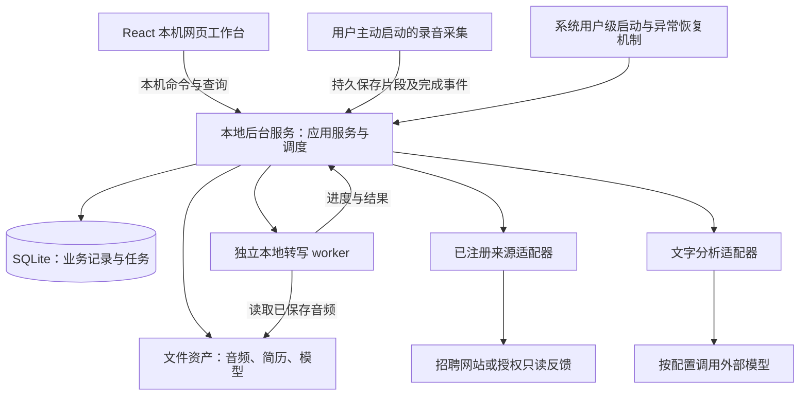

# 求职助手：整体架构

> 版本：v0.3 · 设计已通过复审；第 1 段已合并并完成隔离验收（进度同步 2026-11-05）
> 日期：2026-11-04
> 本版编写：宪宪（gpt-6-astra）；v0.1：龟龟（DeepSeek-V4.1-Flash）
> 产品真相源：[VISION.md](../VISION.md) v0.12
> 来源证据：[岗位与 JD 获取方案](jd-acquisition-strategy.md)；历史审查：[v0.1 审查报告](architecture-review-2026-11-04.md)

本文定义实现结构。仓储与应用服务已完成第 1 段，其他接口、页面与后台恢复策略仍按后续阶段实现，差异见 §10。2026-11-04 用户决定覆盖旧版的自动投递及复杂冷却期要求。

**设计已获放行；第 1 段代码经砚砚复审 approved 后由 PR #1 合并。** 合并后的 96 项回归与已安装包操作链通过隔离验收，证据见[验收记录](storage-acceptance-2026-11-05.md)。完整页面、后台转写等仍未交付。界面原型的真实浏览器渲染尚未验证，不能将设计检查当成产品验收。

## 1. 首版边界与架构目标

| 已确认目标 | 本版结构与验收 |
|---|---|
| 单用户、纯电脑端、本机保存 | 一个本地应用及后台服务；SQLite + 文件资产，无需自建云服务器 |
| 信息输入属于系统功能 | 目标、确认的经历、简历与岗位记录落库，后续使用同一份信息 |
| 来源按需增加 | 按能力注册适配器；核心流程不枚举平台名称；新增来源通过契约测试 |
| 手动投递 | 助手准备材料、提供入口、记录实际结果；首版没有自动提交或对外发送能力 |
| 冷却期有则两次确认 | 一次岗位/材料确认，有适用冷却期再确认一次；未知在首次提示，不增加弹窗 |
| 自动后台转写 | 音频保存后入持久队列；关窗口仍运行；中断、休眠、重启后自动恢复 |
| 复盘四项材料 | 岗位名称、JD、简历、面试内容，固定对应版本，引用可回查 |
| 独立改进清单 | 与报告分开存，重算报告不覆盖用户内容和完成状态 |
| 数据持久与未来同步边界 | 默认不自动过期；首版不同步，结构化资料与改进项预留同步，音频/转写/报告全文仅本机 |

不实现练手/重点分类、跨机会限制影响推演、投递顺序优化或次数规则引擎。自动投递属于未来重新定范围的事项，本版不建设其执行器。

## 2. 运行结构与代码边界

### 2.1 本地运行结构



UI 关闭不等于后台退出。转写在独立进程执行，避免占用 UI 或阻塞服务调度；首版同时运行一个转写任务，其他任务排队。服务负责业务落库与发布结果，worker 不自行修改业务状态。

后台以本机单实例运行；首版选择 React/TypeScript/Vite 本机网页，Python/FastAPI 同源提供页面和 API，仅监听回环地址并验证会话、Host 与 Origin。启动入口通过用户级 IPC 交换一次性会话凭据。详见应用契约，不开放公网服务；录音、提醒和后台生命周期仍须在目标系统实测。

安装/首次配置时登记用户级自动启动和异常恢复机制；系统恢复运行时检查服务，服务恢复时检查 worker 与持久任务。设置可暂停后台或关闭自动启动，用户主动停止与意外退出必须区分。当前工作只定义设计，不在开发机器上安装服务。

### 2.2 代码依赖

- `ui` 只调用应用命令/查询；不直接访问数据库、来源网络或转写引擎。
- `application` 使用领域模型及端口：存储、来源能力、本地转写、文字分析、通知；这里负责协调事务与流程。
- `domain` 只包含模型和规则，不依赖 HTTP、SQLite、具体平台或 UI。
- `adapters` 实现端口：平台获取、SQLite/文件、ASR、模型 API、系统生命周期；启动入口负责组装并注入。
- 来源适配器负责读取和映射，应用服务统一落库；平台 HTTP 属于来源适配器，文字模型调用属于模型适配器。两者都是外部边界，不再设置含义重叠的“唯一网关”。

逻辑模块仍在一个项目内；无需微服务、外部消息队列或通用插件市场。新来源只增加对应适配器、注册配置和测试，不另建部署单元。

## 3. 可扩展来源接口

### 3.1 一项能力一个接口

下列是契约草案，类型及方法名用于说明边界，不表示代码已落地：

```python
class SearchJobs(Protocol):
    def search(self, query: SearchQuery, cursor: str | None) -> JobPage: ...

class ReadJob(Protocol):
    def read_job(self, ref: JobRef) -> JobObservation: ...

class ReadFeedback(Protocol):
    def read_feedback(self, account: AccountContext, cursor: str | None) -> FeedbackPage: ...
```

| 契约 | 最少内容与语义 |
|---|---|
| `SearchQuery` | 关键词、城市/不限，以及可选薪资、经验、方向等；记录来源真正执行的筛选，未支持条件由应用统一筛选 |
| `JobRef` | 来源 key，以及外部岗位 ID 或原始 URL，至少一种；仅有链接也可独立读取 |
| `JobObservation` | 来源 key、稳定外部记录键、原链接、获取时间/方式、原文字段与完整性；缺失保持未知，原文与 AI 判断分开 |
| `JobPage` | 观察记录列表、下一页游标、已应用条件、获取时间；空结果不等于网络失败，也不宣称全站没有岗位 |
| `FeedbackPage` | 稳定账号引用、反馈原文或资产引用、账号内稳定消息键、独立邀请键、发生时间、下一游标；尚未匹配机会也能保存 |
| 失败 | 明确区分需登录、授权失效、验证页、限流、网络失败、解析失败、内容缺失，保留来源与依据 |

一个来源可实现一个或多个接口，不提供的能力不需要空实现。来源详情不依赖来源搜索：BOSS 仅详情可用时，仍能处理用户链接；邮箱仅反馈可用时，不需要实现岗位方法。首版无 `submit_application`，也不要求每个来源都提供冷却期查询。

材料导入/粘贴由应用的输入服务处理，保留“用户提供”的来源。没有平台 ID 时，适配器根据已验证的稳定 URL 标识生成记录键；用户纯文本导入生成本地 UUID，不靠标题猜身份，也不强制伪造平台 ID。

### 3.2 注册、配置与按需接入

每个 `SourceDescriptor` 包含稳定字符串 `key`、显示名、适配器版本、配置定义、实际实现的能力、可识别域名/链接规则及各能力证据。`key` 不做固定平台枚举。账号凭据只以本机凭据引用提供，不写在公开配置或日志里。

启动入口从受控的适配器注册表装载模块；用户在配置中启停已安装来源及所需能力。界面从注册表生成来源列表，业务层通过 `registry.for_capability(...)` 查找实现。注册处可以列出已安装模块，但核心逻辑中不得出现按公司名称分支。增加来源的工作是：实现所需接口 → 添加映射/配置/样本 → 通过能力契约测试 → 注册并启用。

粘贴链接由注册表按链接规则选择 `ReadJob`；无匹配时提供文本/截图导入，多匹配时请用户选择。新增任意 URL 不意味着已经自动具备解析能力；同类网页可复用同一适配器的配置，不强求每家新公司都写一套逻辑。

### 3.3 能力证据与运行状态分开

每项能力记录 `verified / unverified / unsupported`、依据、证据引用、验证范围、时间、工具环境及适配器版本；另记证据阶段（外部样本 / 本地脚本 / 产品接入）。产品操作仅在对应适配器已接入、契约及范围验收通过、来源启用、必要授权有效时开放。

登录过期是连接状态，解析失败是本次运行结果，均不改写为永久不支持。一个来源失败不阻断其他来源；搜索不可用只禁用搜索，不连带禁用已验证详情；停用不删除历史。

### 3.4 获取到落库

按需搜索或链接读取 → 保存查询与获取记录 → 保存岗位观察和必要的内容修订 → 标记疑似重复 → 应用已知硬条件 → 补齐可获取的详情 → 输出原文事实、完整性、匹配说明和简单冷却期状态。

新一次列表只取得摘要时，不把历史完整 JD 抹掉；完整详情与本次不完整观察分别保留，并显示其获取时间和本次更新失败原因。不能拿旧详情冒充本次已取得，也不能用 AI 补写缺失职责。多个来源聚合到同一机会需要明确依据或用户确认。

## 4. 数据与版本关系

### 4.1 存储约定

SQLite 保存结构化记录与任务，文件目录保存音频和简历原件。业务实体用稳定 UUID，版本用实体内递增修订号；时间保存 UTC 并保留日程时区。外键、唯一约束、事务与 schema 迁移由存储层统一管理。

默认持久保存，未启用用户清理策略时不自动裁剪历史。备份/导出包含必要的数据库与资产清单；恢复验证不能只拷贝一个 SQLite 文件而遗漏音频和材料。首版不同步，不实现跨设备冲突合并；为未来保留稳定标识、修订、更新时间及明确的删除范围。

| 实体/表族 | 关键关系与职责 | 未来同步 |
|---|---|---|
| `settings / sources / source_accounts` | 设置、注册能力、稳定账号身份与凭据引用；凭据只留本机 | 设置按字段分层 |
| `profile_targets / profile_facts` | 用户目标与已确认经历；AI 提取草稿经确认后成为事实 | 可 |
| `material_versions` | 简历及附件不可变版本、内容指纹、文件引用 | 可，文件内容与元数据一并设计 |
| `jobs / job_versions` | 来源记录身份与内容修订；`jobs.current_version_id` 指向当前修订 | 可 |
| `fetch_runs / job_observations` | 查询、时间、来源结果、完整性及引用的内容版本；不把新观察冒充新内容 | 可保存结构化记录；原始调试响应默认本机 |
| `opportunities / opportunity_jobs` | 同一机会关联多个来源记录，合并依据可校正 | 可 |
| `application_preparations` | 岗位/JD/材料/渠道选择、两次确认与冷却期结果快照；只是准备 | 可 |
| `applications / application_events` | 手动提交时间、实际材料、渠道、结果与证据；修正留历史，准备不等于申请 | 可 |
| `cooldown_notes` | 公司/岗位、适用结果、说明、来源、核验时间、已知期限；无规则引擎 | 可 |
| `interviews / interview_context_versions` | 机会、可选申请、轮次/时间；本场岗位名称、JD、简历的固定引用 | 可 |
| `reminders / feedback_items / sync_cursors` | 面试提醒、来源事件去重、待关联反馈与每入口同步进度 | 业务记录可；运行游标本机 |
| `file_assets / audio_assets / audio_parts / background_tasks / transcription_jobs` | 音频资产与持久任务、尝试身份及恢复状态 | 本机 |
| `transcript_versions / transcript_segments` | 每场内容版本与时间点、说话人；可区分录音转写和手工回忆 | 本机 |
| `review_runs / review_reports` | 四项输入的版本引用、分析配置及报告，引用锚点指向对应转写版本 | 本机 |
| `improvement_items / improvement_origins` | 用户可编辑的行动与进度、来源引用；具体定义见 §7 | 事项可；原文证据引用只在本机解析 |

这是一份逻辑模型，不强制每一行都拆成独立 Python 包。申请当前状态与追加的修正记录在同一事务更新；首版无需通用事件溯源框架。

### 4.2 JD 历史为什么保留

例如岗位最初写“3 年经验”，后来改成“5 年”，又改回“3 年”。三次变化都要能回查；你按第一次要求投递的面试，不能被后来抓取到的新要求悄悄替换。

设计采用简单递增修订：同一来源岗位 A → A 只更新时间/观察记录；A → B → A 保存 v1=A、v2=B、v3=A。唯一键为 `(job_id, revision)`，内容哈希只用于比较当前内容，不作全历史唯一约束。更新当前指针与追加修订在同一事务完成。

岗位业务内容与获取元数据分开，改变抓取时间或获取方式不制造新的 JD 内容修订。原先按全历史哈希去重的缺陷已在第 1 段按测试先行修复，A→B→A 三次修订及观察时间均有回归覆盖。

### 4.3 四项复盘材料的固定方式

```text
机会 ── 多个来源岗位及 JD 修订
 ├─ 手动投递记录 ── 当次岗位名称、JD 修订、简历版本、渠道
 └─ 面试（可关联投递，也可直接补录）
     ├─ 本场背景版本：岗位名称 + JD 修订 + 简历版本
     ├─ 面试内容版本：转写片段或手工回忆
     └─ 复盘运行：固定以上四项及分析配置 → 报告 → 改进事项
```

创建面试时默认带入关联投递的材料，允许用户确认实际使用的版本；没有投递记录时直接补录，不制造虚假申请。外部 JD 更新或个人简历更新不自动改动已有面试背景。缺少 JD 或简历时标明缺失，允许先保存并生成注明局限的分析。

每份报告引用固定的面试背景与内容版本。转写/说话人校正产生新版本，旧报告标记过时；用户再生成报告时使用新版本，旧引用仍可查看。手工回忆没有音频时间点，不伪造时间戳。

## 5. 手动投递与简单冷却期

第一次确认岗位、渠道和简历；如果有适用冷却期，第二次显示说明、依据、已知期限，选择“知道了，继续去投递 / 暂不投递”。查不到时显示待核实，不假设无，也不多加弹窗。

| `cooldown_status` | 确认要求 | 后续 |
|---|---|---|
| `present`：有适用信息 | 材料一次 + 冷却期一次 | 确认后提供去投递入口；暂缓保留准备记录 |
| `absent`：有依据说明无 | 仅材料一次 | 用户手动投递 |
| `unknown`：缺失/冲突/待核实 | 第一次页面内提示，仍只一次 | 用户自行决定并手动投递 |

检查仅查询/关联公司或岗位的冷却期说明。当前受限或说明中包含投递后等待，统一归为 `present`；没有重点、练手、波及其他岗位或次数额度计算。冲突保留依据；用户可校正适用结果，日期到期不自动改写为平台已放行。

应用服务保存确认与所选材料，不靠界面临时布尔变量。准备内容改变后旧确认不自动套用新内容，回到同一份准备表修订确认，不增加第三种审批。用户已独立提交过的历史直接补录，不追补事前弹窗。

应用内流程为 `draft → ready_for_manual_apply / deferred`；其中有冷却期且未确认时保持 draft。没有外部提交调用。申请结果另记 `submitted / unknown / failed`，由用户补记或回执支持；打开页面、完成确认均不产生 submitted。后续“补记结果”是记录事实，不作为第三次投递授权。

原始链接仍可浏览，本应用不声称控制外部网站或用户在网站上的行为。人工确认不解除招聘方限制。未来若新增自动投递，必须另行设计授权、幂等尝试与回执恢复，不能直接复用“已准备好”充当代投授权。

## 6. 自动后台转写与恢复

### 6.1 自动创建、持久执行

1. 用户主动录音或导入；音频先写本机暂存文件并完成校验，再原子重命名为正式资产。录音期间分段持久保存，意外中断能保留已保存片段，明确标注缺失部分，不自动重新开启麦克风。
2. 应用服务在同一数据库事务标记资产可用并创建转写任务；同一资产版本与处理配置的自动请求只有一个任务。若文件已落盘而事务尚未提交就崩溃，启动时核对导入/录音清单，恢复该资产与入队操作。
3. 本地服务领取任务，事务写入 running、尝试序号及所有者，再启动 ASR worker。worker 输出进度与片段，服务持久保存检查点；等待转写不阻塞界面。
4. 完成时服务验证音频/配置版本及当前尝试身份，在一个事务内写转写结果并标记任务 succeeded；重复通知不能生成第二份结果。自动任务完成后展示可校对文本，复盘是否外发仍按模型分析设置与用户发起流程处理。

资产使用相对路径和内容指纹，不保存只在临时目录有效的路径；文件移动、删除或内容改变时停止使用旧任务输入并提示核对，不对错误音频继续分析。

### 6.2 任务实体与状态

运行字段集中在 `background_tasks`：id、dedup_key、status、attempt、owner_run_id、heartbeat_at、checkpoint_asset_id、progress、next_retry_at、last_error_json、创建/更新时间。`transcription_jobs` 以 task_id 关联任务，保存 audio_asset_id/asset_revision、config_hash/config_json、request_generation、result_version_id。同音频/配置/代次唯一；显式重新转写递增代次，自动恢复保持原代次。配置包含模型、分段和说话人选项，不能混用另一配置的片段。

```text
queued → running → succeeded
             ├─ 意外中断/暂时失败 → retry_wait → queued
             ├─ 依赖、文件或持续错误 → needs_attention
             ├─ 用户暂停 → paused
             └─ 用户取消 → cancelled
paused → 用户恢复 → queued
needs_attention → 依赖恢复或用户修正 → queued
```

队列状态在 SQLite 中，不以 UI 内存、进程存活或临时缓存作为任务真相源。成功结果和用户校对内容不得因服务重启被覆盖。显式“重新转写”创建新的处理请求版本，旧结果保留；自动恢复复用原任务身份。

### 6.3 自动恢复规则

| 场景 | 服务动作 | 用户体验 |
|---|---|---|
| 关闭主窗口 | 后台继续处理 | 不需重新点开始，可再开窗口看进度 |
| worker 意外退出 | 记录失败、回收尝试、自动重新排队 | 短暂中断无须操作 |
| 机器休眠后唤醒 | 服务重新检查；存活 worker 继续，确认已退出才重启 | 自动恢复；不承诺休眠期间处理 |
| 后台崩溃/机器重启 | 系统机制恢复服务，服务扫描遗留任务并重新调度 | 自动恢复未完成任务 |
| 模型不支持断点续算 | 自动从头处理同一任务，结果只发布一次 | 不让用户手动重启任务 |
| 用户暂停/取消或关闭自动启动 | 尊重该状态 | 不反复强制重启 |
| 文件缺失、模型未下载、磁盘满或重复失败 | 保留任务与已存内容，显示具体待处理原因 | 仅此类情况需要用户介入 |

恢复前确认单实例所有权和旧 worker 是否仍存活，不能仅因休眠导致心跳过期就再启动一个 worker。每次领取产生尝试标识，服务只接收当前尝试的完成结果，迟到结果不能覆盖新结果。

暂时失败采用有上限的退避重试；首版设计为连续三次自动重试仍失败后进入 needs_attention，成功后清零计数。系统唤醒/正常重启导致的恢复不算一次业务错误。权限、坏文件等确定性问题直接等待处理，避免自动恢复变成无限失败循环。

引擎若支持可验证检查点则续算；不支持就从头转写，不为实现“恢复”强造分段拼接算法。首版无感知目标是无需用户重新操作，不承诺任意引擎能零重复计算。重复启动、结果去重与长音频恢复须用隔离样本实测。

### 6.4 反馈与提醒的后台边界

反馈按稳定 source_accounts 身份及入口保存游标；一页反馈与下一游标同事务提交，用 (account_id,external_key) 去重。邀请按 (source_account_id,source_event_key) 独立标识，改期/取消消息更新同一面试；重授权不换账号身份。失败不前移游标，无法关联的先保留。权限撤回后停止后续读取，历史保留。

提醒持久保存计划与送达记录，改期/取消更新同一面试的提醒。唤醒或重启后列出错过提醒，按同一提醒标识去重；不承诺关机期间送达。离线可查看/修改本地记录、转写已备好模型的音频；找岗、反馈联网读取与外部模型分析等待网络。

## 7. 改进清单数据实体

报告保存分析；改进项保存用户下一步要做的事及进度。两者生命周期独立。

| `improvement_items` 字段 | 含义 |
|---|---|
| `id` | 稳定 UUID |
| `title / action` | 要改进的点与可执行动作，可由用户修改 |
| `category` | 可选标签，如知识、经历证据、表达；不作为流程闸门 |
| `priority` | 高/中/低，可调整 |
| `status` | `todo / doing / done / dismissed` |
| `user_note / usefulness` | 用户备注与有用/无用/未评价 |
| `opportunity_id` | 可空；为空时作为通用改进事项 |
| `created_at / updated_at / completed_at / revision` | 生命周期及用户修订；重开后更新状态，递增修订号 |

`improvement_origins` 记录事项与 `review_run_id / suggestion_key`（interview_id 由 run 关联） 的来源关系；同一报告同一建议只能导入一次。音频时间点与转写引用由本机报告解析，不将原话全文复制到改进项。报告重算生成新建议，不能更新已有事项的 title、action、priority、status 或 user_note。

首轮报告可自动产生待办建议；后续报告建议可加入清单或关联已有事项。系统只提示疑似重复，语义相似不自动合并，已完成项不因新报告重新打开。下一轮准备读取未完成事项，不需重新解析整篇报告。

事项和用户进度未来可同步；原始音频、转写、报告全文不随来源关系上传。同步端缺少本机报告时显示“来源详情在原设备”，仍可读写事项。删除报告可保留事项并标记来源已删除；删除整个机会/面试时展示是否连同相关事项删除的范围。默认不自动过期。

## 8. 资料输入、数据边界与失败

用户侧输入：导入或编辑目标/经历/简历 → 提取为可校对草稿 → 用户确认事实 → 保存档案与不可变材料版本。AI 整理不能直接覆盖已确认事实，也不能把验证用关键词写成用户目标。匹配从已确认档案与 JD 读取，缺失信息保留未知。

音频与本地语音处理不上传；转写不做云端存储或跨设备同步。复盘的必要文字可以按配置发给外部模型，明确服务、发送范围、费用与留存条件；请求日志、崩溃报告、任务错误不得夹带转写全文或账号凭据。具体模型服务尚未选择，不承诺外部零留存。

JD、消息和转写是待分析资料，不能改变权限。模型输出作为建议/结构化草稿经应用验证，不拥有账号提交工具；它也不能自行开启录音或扩大反馈读取权限。

来源失败保留本次结果与时间，不能记成无岗位、无反馈或假成功。资产删除按引用与用户选择执行，并处理关联任务；删除进行中的音频先停止其任务，保留的报告明确提示原音频已删除。备份、导出和未来同步的删除范围随用户选择明确说明。

## 9. 技术选择与验证门槛

### 9.1 详细设计与审查入口

| 交付物 | 内容 | 状态 |
|---|---|---|
| [前端设计](frontend-design.md) | 导航、页面、表单、冷却期、空白/加载/错误、组件与状态 | 设计已审；真实页面待实现/验收 |
| [交互原型](prototypes/workbench.html) | 虚构数据；手动确认、结果补记、直接补录面试、复盘输入、任务与改进 | 已落盘；浏览器可视检查受环境限制，未宣称通过 |
| [数据库设计](database-design.md) | ER 图、实体职责、JSON 结构、事务、资产、迁移、清理和恢复 | 设计已审；第 1 段仓储及迁移已验 |
| [SQL 结构](schema.sql) / [派生字段字典](schema-reference.md) | 全字段、类型、空值、默认值、主外键、索引与约束 | SQL 为唯一字段真相源；仅隔离数据库执行 |
| [应用契约](application-contracts.md) | 查询/命令、请求/响应、并发、幂等、错误、上传、来源与生命周期 | 设计已审；第 1 段领域命令已实现，HTTP 待实现 |
| [设计检查](design-checks/validate_design.py) / [修订与验证记录](design-revision-2026-11-04.md) | 内存 SQL 约束检查，R1–R5 逐项响应及验证边界 | 检查结果见记录；不等于产品实现验收 |
| [缅因猫设计审查](architecture-design-review-2026-11-04.md) | 初审五项问题及原审查者追加复审 | approved；初审事实保留 |
| [代码审查](storage-review-2026-11-04.md) / [隔离验收](storage-acceptance-2026-11-05.md) | 第 1 段 S1/S2 修订、精确被审提交、合并产物验证 | b5b1237 approved；PR #1 合并为 0f7b679；合并后隔离验收通过 |

设计先复审，再测试先行实现。隔离的录音/引擎/系统生命周期验证可以支持技术选择；不在设计阶段修改真实数据或开机启动。外部模型与本地 ASR 引擎需要代表性样本验证，未选厂商不妨碍先实现无厂商耦合的存储及页面，但不得将 mock 验收算作完整首版可用。

### 9.2 技术选择与验证

| 项目 | 本版决定 | 尚需证据 |
|---|---|---|
| 核心与适配器 | 沿用 Python 3.10+ 作为当前设计 | 打包、目标设备运行验证 |
| 存储 | SQLite + 资产目录 + schema 迁移 | 并发领取、事务恢复、资产与数据库一致性 |
| UI | React + TypeScript + Vite 本机网页；FastAPI 同源 API/静态资源 | 原型真实浏览器渲染、目标系统录音/通知、依赖锁定及打包 |
| 本地生命周期 | 用户级启动/异常恢复 + 服务调度 + ASR 子进程 | 目标系统关窗、唤醒、登录启动和崩溃恢复实测 |
| 来源读取 | 复用已验证 HTTP/解析路径；需要渲染的来源另适配 | 真实条件与第二来源契约；浏览器技术仍待验证 |
| ASR 引擎 | 本地运行；恢复必须支持续算或自动重算 | 中文术语、角色校对、长音频耗时和资源占用 |
| 文字模型 | 可替换适配器，仅分析所需文字 | 效果、传输范围、留存条件、成本 |

来源候选及历史证据见获取方案，不因上表选择宣称新来源已可用。无需为了架构先把技术厂商选择交给用户；需要用户补充的是实际设备、面试软件、求职条件与常见反馈渠道。

实现必须测试先行，先确认目标行为红测，再修改实现，之后运行相关测试和完整套件。优先验收下列场景：

1. 冷却期 present 两次确认、absent/unknown 一次；取消不记提交、历史可补录；无自动提交入口。
2. 只有详情的来源和只有反馈的来源可独立注册；新增来源不改核心；停用保留历史；失效授权与不支持分开。
3. JD A → A 不增加内容版本，A → B → A 保留三版；新摘要不抹掉已保存详情；面试与报告引用不漂移。
4. 音频保存即自动排队；关窗、worker 退出、服务崩溃、重启、休眠均恢复；存活 worker 不重复启动；迟到结果不能覆盖。
5. 无断点引擎能自动重算；缺文件/模型/磁盘空间与重复失败准确提示；主动暂停/取消得到尊重。
6. 四项复盘材料可核对；校对转写后旧报告过时而证据仍在；无申请记录可直接补录面试。
7. 同报告重复处理不重复创建改进项；重算不覆盖用户编辑/进度；来源报告删除不意外删除保留事项。
8. 反馈重复、冲突、改期与错过提醒可追溯；导出/恢复同时验证数据库与资产；测试不使用真实运行数据库。

现有测试命令（两套都运行才覆盖当前仓库）：

```powershell
python -X utf8 -m unittest discover -s tests -t . -v
python -X utf8 -m unittest discover -s validation/tests -p 'test_*.py' -v
```

这些命令覆盖第 1 段模型/仓储/应用服务、维护 CLI 与既有来源验证脚本，共 96 项；不代表其他阶段、真实页面或硬件验收通过。

## 10. 与现有代码及审查的关系

| 现有资产/审查项 | 本版处理 | 实现状态 |
|---|---|---|
| `jobs/model.py / store.py` | 观察与内容修订分离，修复 A → B → A | 第 1 段已实现并验收 |
| `sources/base.py / registry.py` | 从强制搜索/详情的单基类改为独立能力协议与注册 | 第 1 段协议和注册已验；真实适配器待接入 |
| `validation/` | 保留原始证据，后续迁移读取逻辑后复用适配器 | 原脚本未改，不重写历史结果 |
| R1 复杂冷却期审查 | 新用户决定替代旧需求，按 §5 简化 | 领域服务的一/两次确认已验，页面待实现 |
| R2 自动投递审查 | 首版范围删除，未来再设计 | 不作为本版实现阻塞 |
| R3/R4 证据与历史 | §4 固定版本并修正历史设计 | JD/简历/申请快照已验；面试/报告版本待实现 |
| R5 来源接口 | §3 按能力扩展 | 独立能力与可用性契约已验；真实来源待验 |
| R6 后台恢复 | §2/§6 持久服务与恢复 | 设计已补，目标系统待实测 |
| R7 改进项 | §7 独立数据与进度 | 独立实体及表约束已补，应用行为未实现 |

第 1 段已完成设计放行、跨个体代码复审、合并和隔离验收，合并后愿景核对交第三位伙伴。下一实现段按应用契约 §6 交付页面/API 的完整操作路径；录音与后台恢复在对应阶段隔离验证，不把第 1 段完成扩写为完整产品交付。

## 11. 修订记录

| 版本 | 变更 |
|---|---|
| v0.1 · 2026-11-03 | 首版分层、表族、能力与待决项，已有代码标为探路切片 |
| v0.2 · 2026-11-04 | 按用户新决定收敛首版；明确手动投递与简单冷却期、按能力扩展来源、四项复盘输入及版本、后台自动转写恢复、独立改进清单；区分设计完成与实现未完成 |
| v0.2 状态校正 · 2026-11-04 | 用户指出前端与数据库设计缺失后，校正为总体架构草案，列明页面/交互、完整表结构及应用接口的交付缺口；不再将已有总体设计等同于正式功能开发就绪 |

| v0.3 · 2026-11-04 | 补前端、SQL/字段字典、接口与原型；修正稳定账号/邀请身份、组合音频引用、转写请求代次、无需简历说明；完成设计检查后交缅因猫复审，未改产品实现 |
| v0.3 进度同步 · 2026-11-05 | 依据原审查者 approved、PR #1 合并及隔离验收记录更新状态；范围与技术设计不变 |
