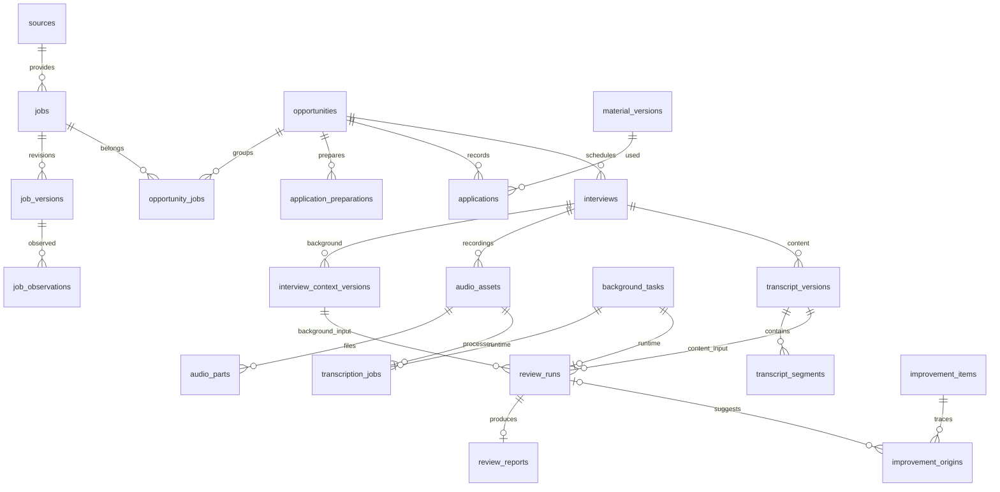

# 数据库与文件设计

版本：v0.3 · 2026-11-04 · 待审查；宪宪 / gpt-6-astra

[schema.sql](schema.sql)是字段、类型、空值、默认值、主外键、唯一约束和索引的唯一详细定义。本文件补充业务含义、JSON 结构和跨表事务；不把 SQL 草案当成已上线迁移。生成的[字段字典](schema-reference.md)供审阅，若冲突以 SQL 为准。[应用契约](application-contracts.md)定义写入入口。

## 1. 存储约定

- SQLite + 本地资产目录，单用户单服务写入，读取使用独立短连接。每个连接开启 `foreign_keys=ON`、`busy_timeout=5000`；正式数据库启用 WAL、`synchronous=FULL`。写事务不得跨网络调用或长推理；忙时返回可重试错误。
- ID 由应用生成 UUID；来源 `key` 是不限定平台的稳定字符串。文本统一 UTF-8；时间固定 UTC RFC3339 毫秒精度，例如 `2026-11-04T06:44:00.000Z`，日程另存 IANA 时区。UUID、时间格式、URL、JSON 内部字段由应用校验。
- 可变聚合的 `revision` 从 1 递增用于并发检查；不可变内容版本的 `revision` 是其实体内递增序号。两者不能混用。新版本在事务内分配，避免两个窗口得到同一号。
- NULL 表示未知/不适用，空串只用于允许为空的用户笔记。未知工资不存 0，未知日程不存当前时刻，未知公司用来源原样名称/“未披露”并附证据。
- 默认为永久保留。没有定时 TTL、自动清理已完成任务或历史内容。普通“移除”是归档；清理原文、资产和整个数据目录是有范围预览的显式操作。
- 原始响应、文字记录、报告、音频仅本机。首版不做同步；未来可同步实体不能直接连带同步本地证据字段。凭据存 Windows 用户凭据设施，只在设置中留 `credential_ref`，不进数据库导出、日志或浏览器缓存。

SQLite 外键需按连接启用，延迟外键用于同事务创建岗位与其当前版本；WAL 的备份不能只复制主文件。本项目据此选择显式连接初始化与备份 API，而非依靠默认配置。[SQLite 外键](https://www.sqlite.org/foreignkeys.html)、[WAL](https://www.sqlite.org/wal.html)、[备份 API](https://www.sqlite.org/backup.html)。这些文档证明数据库机制，不证明本项目恢复逻辑已经实现。

## 2. 核心关系

`file_assets` 是共用的文件清单；`audio_assets` 是一场面试的一次音频集合，`audio_parts` 记录连续录制片段，导入文件通常只有一个 part。复盘任务同时引用同一场面试的背景版本与文字版本，复合外键禁止串到另一场。

### 表职责及主要查询

| 表族 | 职责、写入方式 | 主要读取/索引 |
|---|---|---|
| settings / sources / source_capabilities / source_accounts | 用户设置、安装来源、稳定账号身份、逐能力证据和开关；源码注册表与设置核对 | 主键查询，能力集合很小无需多余索引 |
| profile_targets / profile_facts | 用户确认输入；AI 解析草稿不能充当事实 | 本地个人资料量按列表读取；后续以实际规模增索引 |
| materials / material_versions | 简历身份和不可变版本，保留使用的事实快照 | `(material_id,revision)` 唯一索引 |
| file_assets | 暂存日志、正式文件校验值、恢复所需意图 | ID、相对路径唯一 |
| background_tasks | 小型持久任务队列、尝试身份和进度；无消息中间件 | `status,next_retry_at,created_at` |
| fetch_runs / search_matches | 每次来源调用、实际过滤条件、结果与匹配解释 | 来源时间、任务/岗位版本 |
| jobs / job_versions / job_observations | 来源身份、内容修订、获取观察 | 来源键唯一、最近观察、实体修订、观察时间 |
| opportunities / opportunity_jobs | 用户的机会和确认后的多来源关联 | 状态/更新时间，关联复合主键 |
| cooldown_notes | 追加的适用判断与证据；修改生成新 note | 机会/核验时间；不设复杂限制计算表 |
| application_preparations | 可修订的准备和确认；变更清除确认 | ID / 机会查询；实现按查询计划补外键索引 |
| applications / application_events | 实际手动结果与每次修正的全量快照 | 机会/时间、申请/修订 |
| feedback_items / sync_cursors | 原消息、待关联建议、每入口游标 | 账号/事件唯一；账号/入口游标主键 |
| interviews / interview_context_versions | 可改日程、不可变的本场背景 | 状态/时间、面试/修订；原邀请去重 |
| reminders | 面试或冷却期核验提醒，投递前持久化 | 状态/到期时间 |
| audio_assets / audio_parts / transcription_jobs | 录音或导入集合、片段、固定配置与唯一任务 | 音频/配置/请求代次唯一、片段序号 |
| transcript_versions / transcript_segments | 转写、校对、手工回忆的不可变正文 | 面试/修订、版本/段落键/顺序 |
| review_runs / review_reports | 四项输入与模型配置，结果正文及引用 | task 唯一、run/report 一对一 |
| improvement_items / improvement_origins | 用户拥有的行动、进度与多个建议来源 | 状态/优先级、来源建议唯一 |
| command_receipts / schema_migrations | 命令幂等结果、迁移记录及校验 | 请求 ID / schema 版本 |

这些是数据关系，不对应同等数量的后台服务或页面。`background_tasks` 仅复用持久执行机制；领域任务通过 `transcription_jobs` / `review_runs` 保存强类型输入关系，不建设任意工作流引擎。

## 3. JSON 字段结构（schema_version=1）

API 拒绝未声明字段；下面 `?` 表示可省略，空值按明确 nullable 字段处理。所有 JSON 顶层附 `schema_version:1`；纯数组字段除外。引用型数据同时使用 SQL 外键保存关键关系，JSON 不替代这些外键。

| 字段 | v1 结构与规则 |
|---|---|
| targets.criteria_json | `keywords:string[]` 非空；`cities:string[]` 与 `any_city:bool` 二选一；`conditions:[{field,operator,value,importance:must/prefer}]`；金额包含 currency/period，禁止裸数字 |
| facts.content_json | `title,description,start_date?,end_date?,organization?,result?`；类型特有字段在相应输入模型校验 |
| facts.provenance_json | `kind:user/material_extract,material_version_id?,quote?,confirmed_by:user?`；被引用原文为快照，不随文件更新 |
| material_versions.fact_snapshot_json | `facts:[{id,revision,content}],generation:{provider?,model?,prompt_revision?}`；仅 confirmed 事实；人工版本可空 facts |
| settings.value_json | 按 key 校验：`analysis`（provider/endpoint/model/credential_ref、发送字段）；`background`（auto_start/paused）；`notifications`；`recording`（设备 ID）；`feedback_automation`；未知 key 拒绝 |
| sources.config_json | 由适配器 schema 校验的公开配置；不允许凭据值、任意脚本或任意模块路径 |
| capabilities.evidence_json | `reference,scope,environment,adapter_version,validated_contracts:string[]`；外部样本不能声明 product |
| file_assets.intent_json | `operation_id,purpose,entity_id,staging_path,expected_size?,audio_offset?,config_snapshot?`；路径由服务生成，禁止客户传任意本机路径 |
| tasks.input_json | kind 对应的命令输入快照及来源/配置修订；ASR 真正引用在子表；不包含凭据值 |
| tasks.last_error_json | `code,message,retryable,details?`（脱敏）；result_json 为 `resource_type,resource_id,summary?` |
| fetch_runs.request_json | `query_snapshot?,job_ref?,cursor?,adapter_version`；filters 记录实际执行筛选与未支持项 |
| job_versions.locations_json | 原文地点 `string[]`；未知为空数组，不能推测城市 |
| observations.observed_json | 本次原始可见字段、`completeness,field_presence,errors?`；保存未知及缺失，不能把旧 JD 混入本次观察 |
| search_matches.assessment_json | `criteria:[{condition,result:met/unmet/unknown,evidence:{field,quote}?}],explanation,analyzer?,profile_snapshot`；不虚构置信度 |
| opportunity_jobs.basis_json | `kind:user_confirmed/same_source,description,confirmed_at`；自动同源去重不等于自动跨平台合并 |
| cooldown_notes.evidence_json | `items:[{kind:user/url/document,text,url?,asset_id?,checked_at}],applicability_note`；absent 必须至少一条依据；known_until 是已知期限，不自动算平台放行 |
| preparations.cooldown_snapshot_json | `note_ids,status,explanation,evidence,known_until?`；与 SQL cooldown_status 必须相等 |
| applications.evidence_json | `kind:user_attestation/receipt,statement,asset_ids:[]`；人工补录可以用户声明为依据 |
| application_events.snapshot_json | 当时完整申请字段、准备确认快照（若有）；包含旧版固定 JD/简历引用及当时 resume_exception |
| feedback.proposal_json | `kind:status/interview,proposed_fields,evidence,confidence_basis,conflicts:[]`；不按不透明分数自动建日程 |
| cursors.cursor_json | 适配器 opaque cursor 和 account identity，不含令牌；account_id 外键定位稳定账号；stream_key 只区分入口，不代表账号 |
| contexts.missing_json | `['jd','resume']` 子集；必须与 NULL 引用一致 |
| transcription_jobs.config_json | `engine,engine_version,model_asset_hash,language,chunking,speaker_options,revision`；hash 覆盖整个规范化配置 |
| review_runs.model_config_json | `provider,model,endpoint_id,parameters,sent_fields,consent_revision`；不含 API key；模型选择变化建立新运行 |
| reports.body_json | `summary,limitations:[],findings:[{key,claim,type:observed/inferred,refs:[{segment_key,quote}],jd_refs:[]}],suggestions:[{key,title,action,priority,refs:[]}]`；refs 必须在本次输入版本内可解析，否则不发布结果 |
| origins.evidence_json | `[{transcript_version_id,segment_key,quote?}]`，仅本机；报告被显式清理时移除这些引用，保留来源标签 |

小型集合不提前拆表；会独立查询、引用、更新或需要唯一约束的结构才拆表。应用校验是具体契约的一部分，须测试，不能假设 `json_valid` 已验证业务形状。

## 4. 数据不变量与事务

### JD 修订与旧详情

单次写入：`BEGIN IMMEDIATE` → 通过 `(source_key,external_key)` 查身份 → 对比当前观察的规范化业务内容 hash → 相同则复用当前版本，不同则插入 `revision+1` → 写 observation → 更新 current 与 last_observed → 提交。

hash 排除抓取时间、请求 ID、获取方法；包含标题、公司、原链接/申请链接、职责、要求、资料完整性和已知开放状态。A→A 一版两次观察；A→B→A 三版。唯一约束只限定 `(job_id,revision)`，绝不限定整个历史 hash。

本次只有摘要时保存真实摘要修订，`current_version_id` 指向它，`last_complete_version_id` 仍指向历史完整版本。详情响应分别返回两者及各自观察时间；界面显式选择要用于本次申请的完整 JD。不能把旧正文与新时间拼成一个假完整版本。初次只有摘要时允许记录机会，但缺失字段明确显示。

岗位同源标识由适配器给出：外部 ID 优先，已验证规范 URL 次之；用户文本用 UUID。本地重导入用同一 request_id 去重。跨平台重复只关联机会，不合并来源记录历史。

### 手动准备与实际申请

更新准备时校验 expected_revision，任何输入变动都清空两个确认时间并回 draft。确认命令在事务内读取当前 cooldown snapshot：present 只在第一步后接受第二步；absent/unknown 第一步直接 ready。DDL 检查不能跳过必要时间，应用验证内容和确认步骤。无简历的历史事实可补录；新准备要有简历或用户填写“此渠道无需简历”的明确说明（保存在 preparation.resume_exception，确认后不能为空白；不能静默缺失）。

申请创建/修正在同事务写当前行、`application_events` 完整快照和 `command_receipts`；变为 submitted 必须包含用户声明或回执及实际时间。打开链接只有 UI 动作，不写 submitted。机会当前状态可由明确申请/反馈操作更新，用户修正留在对应事实记录中；不会因超时无反馈自动拒绝。

准备记录不是历史凭证：修改准备不影响已写入 application_events 的当时确认快照。应用验证准备、申请、岗位属于同一机会；面试与申请的机会一致性另由复合 FK 保证。

### 任务领取、暂停与迟到结果

事务内条件更新 `queued → running`，`attempt+1`，生成 `owner_run_id`；返回 `(task_id,attempt,owner_run_id)` 给 worker。所有进度、检查点和完成事件都带此三元组，只有当前 running 尝试可写。暂停/取消先事务改状态并清 owner，再终止子进程；迟到结果被丢弃，不能发布或将暂停变回成功。

首版 ASR 并发为 1。服务以 Windows 用户级互斥锁限制单实例；启动清理上次 service-run 的 worker，检查 PID 与进程启动标识防止 PID 复用。恢复时核实进程是否仍存活，不能仅以休眠期间心跳过期重启另一 worker。断点不兼容时对同一任务自动重算，任务/结果去重键保持不变。

暂时失败重试间隔 5/30/120 秒，最多三次自动重试（首次加三次；第四次失败需处理）；系统休眠、正常服务重启不增加 failure_count。缺文件、模型未就绪、空间不足直接 needs_attention。用户修复后显式 retry 重置失败计数；resume 只恢复主动暂停。成功任务不可再次运行；显式 RetranscribeAudio 分配 request_generation=max+1，创建新任务与文本版本，同配置也允许。自动初次请求代次为 1，自动重试/恢复沿用原代次。同一个 request_id 的重新转写命令只分配一次；旧结果与校对版本保留。新配置从该音频/配置的代次 1 开始。

完成 ASR 时同事务写全文版本、全部 segments、transcription_jobs.result_version_id、task.succeeded/result、命令回执。SQL 的唯一音频版本/配置/请求代次、服务尝试栅栏共同保证“重复通知一份结果”。转写配置内实际模型 hash 固定；缺模型在入队后暂停到 needs_attention，不能偷偷改用云端。

搜索与反馈也存持久任务，逐页提交抓取记录；重复页靠来源 ID/事件键去重。分析请求已经发出但外部结果不明时不自动重发收费请求，转 needs_attention，允许用户决定重试。ASR 的自动重试策略不机械套给外部模型。

### 音频与文件一致性

服务生成 asset UUID 和相对路径，先插入 staging 与恢复意图；流写 `.part` 文件并 flush/fsync，完成校验后同卷 rename 为正式不可变文件；随后事务标记 ready，补齐 audio part，finalize 音频集合并创建唯一转写任务。事务未完成而文件已存在时，启动按 staging 意图重新校验并补完同一操作，不丢任务、不重复新建。

录音以约 10 秒片段持续落盘，每片段都先登记 intent；最后一个不完整片段在能解码时保留并标 partial。关闭/崩溃后的 capturing 音频转 interrupted，已完成片段自动入队，明确缺口，不重新开麦。空录音不建转写任务。导入断线保留部分内容及 upload ID，用户可续传；不能把不完整上传当成完整录音自动发布。

相对路径必须经根目录约束检查，拒绝绝对路径、`..`、符号链接/重解析点越界。原始名称仅展示，不用于目录拼接。先校验头部/解码能力/容量；不执行导入文件。数据库记录缺失文件为 missing；未登记孤儿文件进入恢复列表而非自动删除。磁盘 full 不标保存成功。

### 反馈身份与邀请更新

source_accounts 以 `(source_key,account_key)` 标识稳定的提供方账号，重授权只更新 credential_ref，不换账号 ID。切到另一账号创建/选择另一条 account；停用旧账号保留反馈、日程和游标。账号凭据归属于 account；source 上的凭据仅服务不区分账号的公开/岗位读取。手工导入使用内置 manual/local 账号。

消息身份为 `(account_id,external_key)`；适配器负责把提供方局部消息编号规范为账号内唯一、重拉不变的 external_key。邮箱若 UID 仅文件夹内有效，键须包含提供方必要命名空间，不能仅用数字 UID。sync_cursors 的 `(account_id,stream_key)` 只表示同一账号的读取入口，换凭据不重置消息身份。

邀请身份为 `(source_account_id,source_event_key)`，与一条具体反馈消息分开。原邀请、改期、取消各有独立 feedback row，事务内用稳定邀请键查找并更新同一 interview，source_feedback_id 指向最近一次已采纳消息；同步更新提醒，旧提醒 cancelled。两个账号的同名邀请不相撞。无稳定账号/邀请标识时不得自动建/改日程，进入人工确认；确认关联已有面试不会制造一个新邀请身份。

### 组合文字与音频定位

CombineTranscripts 接收有序 `(version_id,segment_key)` 列表，来源须属于同一场面试。生成 origin=combined 的新版本：每段保存 audio_asset_id、该音频内原始 start/end、source_version_id/source_segment_key；ordinal 仅控制阅读顺序，不冒充合成音频时间轴。整份 version.audio_asset_id 此时为 NULL。每段两个时间码可以都为 00:30，但其音频 ID 不同。

校对生成新版本并继承逐段音频及来源关系；拆段继承来源并校验区间，跨不同音频的两段不能合成一个有单一时间区间的 segment。手工补写没有依据时 audio_asset_id/start/end 为 NULL。点击报告引用先找到固定版本的 segment，再定位音频集合及覆盖原始区间的 audio_parts。旧报告保留旧段；合并/校对、重开窗口都不靠内存恢复来源。SQL 复合 FK 限制来源属于同一场，服务校验时间不越过音频时长与已保存区间。

### 复盘与改进项

发起复盘时固定 context/transcript 版本；context 中固定岗位名称、JD 版本、简历版本。服务校验 missing 与实际引用一致；正文没有段落则不生成。报告出炉前校验引用属于输入版本。旧报告过时是查询计算：其输入不等于当前选用的 context/文字版本，不修改报告正文。

`AddImprovement(run_id,suggestion_key)` 在事务创建 item+origin；重复相同来源返回已有 item。新报告同义建议不自动合并；用户选择关联已有项时只新增 origin。修改/完成 item 只改 item 和 revision，不重写来源。删除报告/复盘链之前清空 origins 的本地证据并设 run NULL，保留 provenance_label 和用户行动；常规归档不做删除。

## 5. 生命周期、索引与约束覆盖

内容版本 UPDATE 由触发器拒绝，更新要插入新版本。补写段落仅发生于结果发布同一事务；发布后禁止再 INSERT/DELETE 段落，由仓储方法与测试保障。DDL 不假装能校验全部状态机：URL安全、JSON内引用、同机会关联、完整性指针、任务kind匹配、时区与已发布集合冻结仍需应用事务校验。

SQL 的 FK 默认 RESTRICT 防止误删引用；只有 improvement_origins.review_run_id 使用 SET NULL。删除服务必须先展示依赖、停止相关任务、备份清理计划，再按子到父顺序执行。文件先标入可恢复隔离目录、数据库事务成功后待用户清理；失败可恢复，不能先永久删文件再操作数据库。无业务入口直接执行任意 SQL。

列表用稳定 `(updated_at,id)` 或 `(observed_at,id)` 游标，排序字段白名单；中文标题搜索首版用参数化 LIKE，小数据量不先建全文检索服务。外键引用列的补充索引见 SQL 尾部；后续变更用 EXPLAIN QUERY PLAN 与真实规模验证，不无依据增加索引。

## 6. 迁移、备份与恢复

新应用数据库 schema 从 v1 开始，迁移文件带 checksum，按顺序事务执行；应用版本与 schema 不兼容时拒绝写入并给恢复说明。`docs/schema.sql` 是待审的目标结构，审查后转为 migration，运行时不重复执行这份设计稿。

现有 spike 只有旧 jobs/job_versions：迁移先识别旧表形状并备份到隔离副本；创建新库，按旧版本 ID 顺序导入来源与内容版本，再以旧 jobs 当前 payload 对照补一个确实缺失的当前修订。保留 old ID→UUID 映射和迁移报告。旧版已丢失的 A→B→A 发生时间不能凭空恢复；标 `legacy_import` 来源与时间不确定，向用户说明已知数据缺口。新库校验通过后才切换，旧库不就地覆盖。未知 schema 拒绝迁移。

备份：取得应用备份锁，暂停发布/迁移/清理（worker 可继续计算但等待发布），用 SQLite backup API 建一致副本；从副本生成所有 ready 资产清单并复制不可变文件，记录大小/hash/schema版本；临时目录完成校验后原子发布备份包，再解锁。凭据不导出。复制失败保留失败状态，不把半包称成功。活跃录音先停止并保存，或让用户稍后备份；不声称可备份未写完的音频。

恢复：解包到新目录 → 拒绝路径穿越 → 校验 manifest/hash/schema/FK/integrity → 列出缺失资产与影响（缺失则拒绝替换）→ 关闭当前服务与 worker → 切换数据根目录 → 重新登录外部凭据 → 按恢复规则处理任务。原目录保留，成功前不覆盖。备份中的暂停/取消保持；running 清旧 owner 后排队，本地 ASR 可重算，外部分析结果不明保持 needs_attention。

## 7. 验证边界

使用 [validate_design.py](design-checks/validate_design.py) 在 `:memory:` 执行 DDL 并检查 FK、修订历史、确认约束、跨面试引用、任务去重和独立改进项。它验证设计约束，不运行生产迁移，也不证明应用层重试/录音/恢复已实现。正式实现仍必须先红后绿并运行两套现有测试及新增集成测试。
